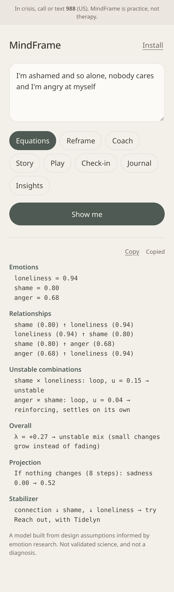

# MindFrame

MindFrame is a coping-skills practice tool for your phone. It is one calm screen: you write what's on your mind, pick what you'd like back, and read the answer below.

A safety line stays at the top. If anything you type looks like a crisis (thoughts of suicide or self-harm), the only response is a support box with **988** (Suicide & Crisis Lifeline, US) and **911**. Nothing is generated and nothing is saved. Every action checks the text again, including text typed inside an answer.

MindFrame is practice, not a substitute for therapy. Everything runs on the phone; nothing is sent to a server.



## One screen

1. **Input:** one box, "What's on your mind?"
2. **Choices:** pick what comes back. The choice is remembered next time.
3. **Output:** the answer appears below. All text in it can be selected, and a small **Copy** button copies the text of the answer. Sliders, steps, and games work right inside the output.

| Choice | What you get back | Needs words? |
|---|---|---|
| **Equations** (default) | The emotion equation engine: emotions found, how they push on each other, unstable combinations, overall λ, and one stabilizer skill | yes |
| **Reframe** | The Grounding Loop on your thought: grip, one test question, reframe suggestions, one small step | yes |
| **Coach** | One coach chosen from what the analyzer noticed, plus the other angles and the evidence lists with believability | yes |
| **Story** | A short, calm story with a made-up creature guide | yes |
| **Play** | Three small games from the story pieces (uses a sample thought if the box is empty) | no |
| **Check-in** | The 30-second daily check-in and one next skill | no |
| **Journal** | Save what's in the box, and read what you saved | no |
| **Insights** | Weekly card, a 7-day chart, today's next skill, weekly patterns | no |

Every other choice also shows one short **Equation view** line from the same engine (Reframe, Coach, Story, Play), Check-in shows its Ψ equation with today's numbers, and Insights adds a 7-day instability (λ) trend.

Old links still work: `?view=reflect` opens Coach, `?view=ground` opens Reframe, and `?view=journal` and `?view=insights` open those choices. On a keyboard, arrow keys move between choices and Enter shows the answer; Ctrl+Enter in the box does too.

## Privacy

Thought text is stored only when you tap **Save what's in the box** in Journal, or **Save to journal** on the weekly card. Everything else keeps numbers (groundedness, check-in answers, counts of stories and games, one λ number per day from the equation engine) or nothing at all.

## Equations: the emotion engine

**This is a model, not validated science.** The words, weights, and thresholds below are design assumptions informed by general emotion and CBT research. They have not been tested in a study, they are not a diagnosis, and the numbers are not a measurement of you. They are a way to look at a hard moment from a little distance. The code is in `js/emotions.js`; every weight is in one table there and can be changed.

**1. Emotion vector.** Ten emotions: joy, hope, calm, connection (helpful) and fear, anger, sadness, shame, guilt, loneliness (hard). Each word or phrase in a small lexicon adds a weight `w` to its emotion (`ashamed` → shame 1.0, `nobody cares` → loneliness 1.0). Then:

- an intensifier just before the word multiplies it (`very` ×1.5, `so` ×1.4, `extremely` ×1.7…); a softener lowers it (`a little` ×0.6);
- a negator within the 3 words before flips it to a nearby emotion at half weight (`not happy` → sadness, `not afraid` → calm);
- the existing analyzers add amplifiers: hopeless wording → sadness +0.6 and hope ×0.5; self-blame → shame +0.4, guilt +0.3; harsh labels → shame +0.3; mind reading → fear +0.2, shame +0.2; worst-case wording → fear +0.3; curse/sign language → fear +0.4; absolute words (`always`, `never`) make the hard emotions ×(1 + 0.15·n), n ≤ 2;
- `e_i = 1 − exp(−raw_i)`, so more evidence gets closer to 1 without passing it.

**2. Influence matrix W.** `W[i][j] > 0` means emotion i amplifies j; `< 0` means it dampens j. Assumed links include shame ↔ loneliness (0.5 / 0.4: hiding and isolating), sadness ↔ loneliness (0.4 / 0.5: withdrawal), guilt ↔ shame (0.4 / 0.3), fear ↔ anger (0.3 / 0.2), shame ↔ anger (0.35 / 0.2), and dampeners such as connection → loneliness −0.6, connection → shame −0.5, calm → fear −0.5, hope → sadness −0.4.

**3. Dynamics.** `e(t+1) = clamp01( e(t) + h·(Wᵀ·e(t) − d·e(t)) )` with `h = 0.15`, `d = 0.3` (each feeling fades on its own). The Projection line runs 8 steps and names the feeling that moves most "if nothing changes".

**4. Unstable combinations.** For two present emotions that amplify each other, the loop strength is `u_ij = W_ij·W_ji·e_i·e_j`; loops with `u ≥ 0.025` are listed. A loop of hard feelings is **unstable** on its own when `√(W_ij·W_ji) − d > 0` (it grows faster than it fades), otherwise **reinforcing** (it settles on its own). Loops of helpful feelings are **steadying**. A **tension** pair is a helpful and a hard feeling that dampen each other (a tug-of-war).

**5. Overall λ.** On the active emotions (`e > 0.1`), the Jacobian is `J = Wᵀ − d·I`, and λ is the largest real part of its eigenvalues (QR iteration, all local). `λ > 0`: small changes grow instead of fading (a feeding loop, or a tug-of-war where one side wins). `λ ≤ 0`: the mix settles back.

**6. Stabilizer.** The helpful emotion that dampens the unstable pair most, with one skill and a guide: connection → Reach out (Tidelyn), calm → Paced breathing / TIPP (Mistfawn), hope → One small step (Hivewright), joy → One pleasant activity (Pell).

When the words show no thinking pattern, Story and Play take their guide from the strongest hard loop (shame or guilt → labeling, loneliness or sadness → hopelessness, fear or anger → catastrophizing). The words win when they show a pattern.

Example, for "I'm ashamed and so alone, nobody cares and I'm angry at myself":

```
Emotions
  loneliness = 0.94
  shame = 0.80
  anger = 0.68
Relationships
  shame (0.80) ↑ loneliness (0.94)
  loneliness (0.94) ↑ shame (0.80)
  shame (0.80) ↑ anger (0.68)
  anger (0.68) ↑ loneliness (0.94)
Unstable combinations
  shame × loneliness: loop, u = 0.15 → unstable
  anger × shame: loop, u = 0.04 → reinforcing, settles on its own
Overall
  λ = +0.27 → unstable mix (small changes grow instead of fading)
Projection
  If nothing changes (8 steps): sadness 0.00 → 0.52
Stabilizer
  connection ↓ shame, ↓ loneliness → try Reach out, with Tidelyn
```

Crisis text is checked first: the engine returns nothing and the support box is shown. The output never repeats your words, and only one λ number per day is stored (`mindframe-lambda`).

## Reframe: the Grounding Loop

A rule-based guide for heavy, hard-to-prove thoughts ("I'm cursed", "nothing will ever change"). It is a guided tool, not a therapist.

1. **Name it.** The guide looks for mirage wording (absolute words, curse/fate/sign/punishment language, mind reading, predicting the future, harsh labels) and suggests how strong its grip is (M). You move the slider.
2. **Test it.** One question that fits what it noticed, plus fact, fear, or belief.
3. **Reframe it.** Two or three true, hopeful sentences to start from. Edit freely, then rate how true it feels (H).
4. **Act on it.** One small step (a short prayer, a text to a friend, a walk, a two-minute task), then choose: the real one (+1), not sure (0), or the old thought (−1).

Groundedness updates with `G_next = clamp01(G + 0.2 × r × (1 + H − M) / 2)`, starting at 0.5. The real version always raises it, the old thought always lowers it, and not sure leaves it. **Tell me a story** on steps 3 and 4 makes a story from your reframe and step.

## Coach

Five coaches: DBT Coach, Philosopher, Thought Equation, Compassion Coach, and CBT Coach. One is shown first; **See other angles** opens the rest. The Thought Equation asks for evidence for and against; believability is evidence for, divided by all the evidence, times (1 minus 0.15 times the number of thinking traps). That number (not the text) can fill in the check-in. Very big-ambition wording gets a respectful **One small step** card. Technique text lives in `js/cbt-techniques.js` with its sources.

## Story

Each kind of thought has its own made-up guide, reused from Project Veda where possible: Lumowl (hidden meaning), Mistfawn (predicting), Tidelyn (mind reading), Hivewright (absolute words), Pell (harsh labels), Brakkor (worst case), Sela (hopeless), and Nim (anything else). The guide feels a thought like yours, notices one real thing, says a truer sentence, takes a small step, and ends steadier, with no magic fix and no promises, then asks you a gentle question. **Another story** changes the wording. **Include faith** starts on only for curse, sign, or punishment thoughts; **Tell it to me** switches to "you". **Play this story** opens it as a game.

## Play

- **Choose a path:** four short scenes, each with one mirage choice and one or two grounded ones. The mirage gets a kind note and you try again; there is no game over.
- **Spot the mirage:** sort six short lines into mirage or real, with a short reason for each.
- **Rebuild the sentence:** tap the shuffled words of a true sentence in order.

A steadiness meter (0 to 100) only rises. At the end, **Log as a Ground loop** counts it as a real choice (r = +1); nothing is logged unless you tap it.

## Check-in and Insights

Five quick answers: distress (0–10), connection (1–5), planned skills used (None, Some, Most, All), pushing hard feelings away (1–7, adapted from the AAQ-II), and how much you believe the hard thought (0–100). They form the Ψ index from the combined paper, `Ψ = 0.18C + 0.14S + 0.12M − 0.26R − 0.31B`, scored 0–100 as `100 × (Ψ − min) / (max − min)` with min = −(wR + wB) and max = wC + wS + wM. Under **Advanced** you can change the size of each weight (signs stay fixed) or reset to the research values, which come from published correlations and are a starting point, not a validated score. One card then suggests one next skill for the weakest part of the day.

Insights shows a 7-day chart of the check-in score and groundedness. If either stays under 30 for three days in a row, a soft note suggests reaching out to someone you trust, and 988. With 7 days of data, a weekly card sums up the week and asks what helped most; the answer is kept only if you tap Save. Saved Journal entries feed a weekly bar chart of thinking traps.

## Install and run

MindFrame works offline. `manifest.json` uses a relative scope, and the service worker caches the app with relative paths, so the same files work at `http://localhost:8000` and on GitHub Pages under `/mindframe/`. An **Install** button appears when the browser offers it.

```bash
python3 serve.py
```

Then open [http://localhost:8000](http://localhost:8000).

Tests (no dependencies): `node tests/emotions.test.js`, `node tests/grounding.test.js`, `node tests/stories.test.js`, `node tests/psi.test.js`, `node tests/games.test.js`.

## Research paper

- [MindFrame: An Inner Language for Self-Talk, an Integrated Low-Overload Framework, and the Ψ Daily Reflection Index](paper/MindFrame_Combined_Paper.pdf) combines MindFrame with the Psi daily reflection index, and names the next project, MindFrame Psi-Lab.
- [MindFrame: Toward an Inner Language and an Integrated, Low-Overload Framework for Self-Talk Support](paper/MindFrame_Paper.pdf) is the original concept paper on MindFrame's framework.

## File structure

```
index.html              the one screen: input, choices, output
style.css               calm phone layout
manifest.json           install metadata, relative scope
sw.js                   offline cache
serve.py                static server on port 8000
icons/                  home-screen icons
js/analyzer.js          keyword patterns, traps, crisis, big-ambition language
js/grounding.js         Grounding Loop: mirage reading, update rule, history
js/stories.js           story templates and creature guides
js/psi.js               check-in math: Ψ, weights, next skill, weekly summary
js/games.js             path, spot-the-mirage, and word-tile games
js/emotions.js          equation engine: emotion vector, W, dynamics, loops, λ, language
js/cbt-techniques.js    local CBT exercises
js/bots.js              five coaches, believability, which coach goes first
js/app.js               the screen: choices, crisis, copy, Coach, Journal, Insights
js/equations-ui.js      Equations output, Equation view lines, λ trend
js/ground-ui.js         Reframe and Story outputs
js/play-ui.js           Play output and the steadiness meter
js/checkin-ui.js        Check-in output, weights, chart, weekly card
js/start.js             first choice on open, old ?view= links
tests/                  node tests for emotions, grounding, stories, psi, games
screenshots/            the one screen with Equations, Reframe, Story, Play, Insights, crisis
paper/                  research papers (PDF and LaTeX)
```
