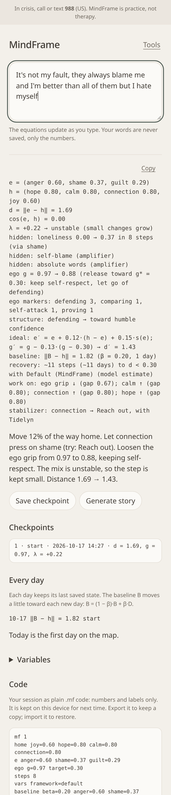
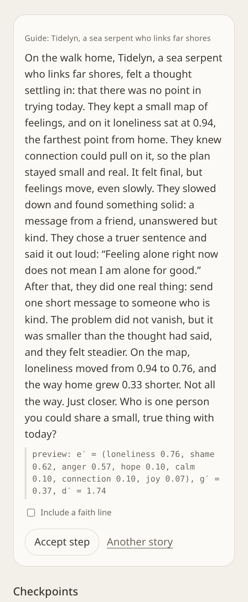
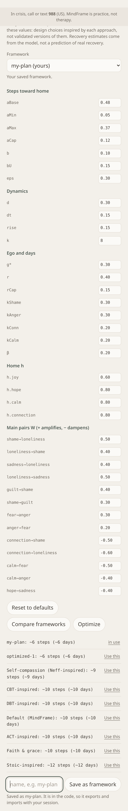

# MindFrame

MindFrame is a coping-skills practice tool for your phone. It has two pages:

- **Workspace** (the main page): write what's on your mind and watch it turn into equations as you type: where your feelings are, how far they are from a steadier "home", which combinations are unstable, and one small, balanced step toward home. Save checkpoints, generate a short story built from that step, and export or import the whole session as plain `.mf` code.
- **Tools** (`tools.html`, the **Tools** link at the top): every earlier choice, working as before: Equations, Reframe, Coach, Story, Play, Check-in, Journal, Insights.

A safety line stays at the top. If anything you type looks like a crisis (thoughts of suicide or self-harm), the only response is a support box with **988** (Suicide & Crisis Lifeline, US) and **911**. Nothing is generated and nothing is saved. Every action checks the text again, including text typed inside an answer.

MindFrame is practice, not a substitute for therapy. Everything runs on the phone; nothing is sent to a server.



## Workspace: equations, checkpoints, code

**This is a model, not validated science.** The home vector, weights, and step rule are design assumptions. They are not a diagnosis and not a measurement of you. The home vector is one picture of a steadier place, not a rule for how anyone should feel.

**Live equations.** About 0.4 s after you stop typing, the equation engine (below) reads the box and shows:

| Line | Meaning |
|---|---|
| `e = (…)` | the current emotion vector (ten emotions, each 0 to 1; zeros left out) |
| `h = (…)` | the home vector: joy 0.60, hope 0.80, calm 0.80, connection 0.80, every hard feeling 0 |
| `d = ‖e − h‖` | distance from home |
| `cos(e, h)` | how much e points the same way as home (0 if e is all zero) |
| `λ` | largest real eigenvalue of `Wᵀ − d·I` on the active **hard** feelings; `λ > 0` means small changes grow |
| `unstable:` | hard-feeling loops that grow on their own (`√(W_ij·W_ji) > d`) |
| `hidden:` | feelings you didn't name (`e ≤ 0.1`) that the dynamics raise by 0.15 or more within `steps` steps, with the feeling that drives them; and pattern amplifiers found in the words (absolute words, curse/sign language, harsh labels…) |
| `ideal:` | the next balanced step and the distance after it |
| `work on:` | unstable loops first, then the three biggest gaps to home |
| `stabilizer:` | the helpful feeling that dampens the hard ones most, with one skill and a guide |
| `ego g = …` | ego grip now → after the next step, and toward the appropriate ego g* |
| `ego markers:` | which ego markers the words show (defending, comparing, self-attack, proving, replaying) |
| `structure:` | the mental structure now → toward humble confidence |
| `baseline:` | the daily baseline's distance from home |
| `today:` | whether today's change points toward home (↑), sideways (↔), or away (↓) |
| `recovery:` | model estimate of steps (and days) until close to home with the current framework |

**Words add to the saved state.** A restored checkpoint, an accepted step, or the last session is the *base*. New words add to it: `e = 1 − (1 − base)·(1 − words)`. Your words are never stored; only the numbers are.

**The ideal step** (`js/workspace.js`):

```
e' = e + a·(h − e) + b·s(e)
s_j = e_j · Σ_{i helpful} min(0, W_ij)·h_i      for each hard feeling j above its home value
a  = clamp(0.2·(0.5 + d/d_max), 0.05, 0.25)      bigger steps when far from home
if λ > 0:  a = max(0.05, min(0.12, a/(1 + 4λ))),  b = 0.15     (smaller, steadier steps when unstable)
else:      b = 0.10
```

`s(e)` is the pull that home's helpful feelings (connection, calm, hope, joy) have on the hard ones. No value is allowed to pass its home value, and values move by at least 0.01, so the distance to home goes down at every step and reaches 0. The raw dynamics term `W·e − d·e` is left out of the step on purpose: in an unstable mix it would feed the loop away from home.

### Ego: releasing to an appropriate ego

**Ego grip `g`** (0 to 1) is how much self-focused defending, comparing, self-attack, pride, or replaying shows in the words. Self-attack counts too: "I hate myself" still puts the self at the center, only louder. Markers (each kind counts at most twice):

| Kind | Weight | Examples |
|---|---|---|
| defending | 0.6 | not my fault, they always / they never, I'm right, it's their fault, blame me, wasn't me |
| comparing | 0.5 | better / worse / smarter … than, everyone else, compare myself, not as good as |
| self-attack | 0.6 | I hate myself, I'm stupid / worthless / a failure …, my fault (not "not my fault"), what's wrong with me |
| proving (pride) | 0.5 | better than all of them / everyone, I'm the best, beneath me, I deserve better, they're all idiots |
| replaying (rumination) | 0.4 | why me, I keep thinking / replaying, can't stop thinking, over and over |

Self-focus adds `min(0.3, 0.5 · (I/me/my words ÷ all words))`, counted only in sentences that carry a hard feeling or a marker. Then `g = 1 − exp(−raw)`, and new words add to the saved g the same way they add to e.

**Appropriate ego `g*` = 0.30.** This is healthy self-respect. The goal is not zero, and the target can be changed.

```
g' = g − r·(g − g*)            never past g*; at least 0.01 when not there yet
r  = 0.25;  when λ > 0:  r = min(rCap = 0.15, r/(1 + 4λ))
```

When `g` is below `g*` (very low self-worth), the same rule raises it toward `g*`. Each change `Δ = |g − g'|` also nudges, never past home, shame by −0.3·Δ, anger by −0.3·Δ, connection by +0.2·Δ and calm by +0.2·Δ. The **structure** line names where you are (defending, comparing, proving, self-attack, replaying, self-focus, low self-respect, steady self-respect) and where you are heading: **humble confidence**, meaning g near g* with calm and connection at 0.5 or more.

When the ego gap `|g − g*|` is bigger than any hard feeling's gap, the story is about letting go of defending or comparing while keeping self-respect. Pell is the guide, and the one step fits the main marker. An optional faith line about grace or humility appears only when **Include a faith line** is ticked.

### Every day: a vector into the baseline

Each calendar day keeps one day vector `D_t = [e, g]`, the last checkpoint or accepted step of that day. The baseline is an exponential moving average:

```
B_1 = D_1,   B_t = (1 − β)·B_{t−1} + β·D_t,   β = 0.20
v_t = D_t − D_{t−1}                       today's direction
alignment = cos(v_t, [h, g*] − B_{t−1})   ↑ toward home if > 0.15, ↓ away if < −0.15, ↔ otherwise
```

Once days are recorded, the step size uses the baseline's distance `‖B − [h, g*]‖` instead of today's. So each day is one step into the baseline, and the baseline drifts toward home over time. **Every day** lists the last 7 days with the baseline's distance and an arrow, plus one gentle sentence for today.

### Variables and frameworks

**Variables** (collapsed) lists every number the equations use. Values are kept inside their ranges, and `aMin ≤ aCap ≤ aMax` and `rCap ≤ r` are always enforced. **Reset to defaults** puts them back.

| Variable | Default | Range | Meaning |
|---|---|---|---|
| `aBase`, `aMin`, `aMax` | 0.20, 0.05, 0.25 | 0.05–0.5, 0.01–0.2, 0.05–0.5 | step toward home: base, smallest, largest |
| `aCap` | 0.12 | 0.02–0.3 | step cap when the mix is unstable |
| `b`, `bU` | 0.10, 0.15 | 0–0.5 | stabilizer pull (stable, unstable) |
| `eps` | 0.30 | 0.05–1 | recovery threshold |
| `d`, `dt` | 0.30, 0.15 | 0.05–1, 0.05–0.5 | decay, dynamics time step |
| `rise`, `k` | 0.15, 8 | 0.05–0.5, 1–50 | hidden-variable threshold and horizon |
| `g*`, `r`, `rCap` | 0.30, 0.25, 0.15 | 0.1–0.6, 0.05–0.6, 0.02–0.4 | ego target, release rate, release cap when unstable |
| `kShame`, `kAnger`, `kConn`, `kCalm` | 0.3, 0.3, 0.2, 0.2 | 0–0.6 | ego release coupling |
| `β` | 0.20 | 0.05–1 | baseline weight of each new day |
| `h.*` | joy 0.6, hope/calm/connection 0.8 | 0–1 | home vector |
| main pairs of W | see Equations | −1 to 1 | 13 main amplify (+) and dampen (−) pairs |

**Frameworks** are just sets of these values. They are design choices *inspired by* each approach, not validated versions of them:

| Framework | What changes |
|---|---|
| Default (MindFrame) | nothing |
| DBT-inspired | stronger calm pulls (calm→fear −0.7, calm→anger −0.6, calm→shame −0.35), b 0.14, bU 0.20, kCalm 0.3, home calm 0.9 |
| CBT-inspired | more sensitive hidden variables (rise 0.10, k 10), stronger hope pulls (hope→sadness −0.5, hope→fear −0.35), aBase 0.22 |
| ACT-inspired | feelings allowed to pass (d 0.35), r 0.3, lower ego target 0.25, values home connection 0.9 and hope 0.85 |
| Self-compassion (Neff-inspired) | connection→shame −0.8, connection→loneliness −0.7, kShame 0.45, kConn 0.3 |
| Stoic-inspired | calm→fear and calm→anger −0.6, home calm 0.9 and joy 0.5, aBase 0.18, b 0.12 |
| Faith & grace | home hope and connection 0.9, hope→sadness −0.5, hope→fear −0.3, ego target 0.25, r 0.3 |

Editing any value switches to "custom variables". **Save as framework** keeps the current values under a name (a–z, 0–9, dashes). Saved frameworks are written into the code, so they export and import with the session.

### Recovery estimate

`T_rec` is the number of ideal steps, simulated from the current e and g with the current variables, until `‖[e, g] − [h, g*]‖ < eps`. The simulation stops at 200 steps and says "not reached" if it gets there. Days are `⌈T_rec ÷ rate⌉`, where the rate is the average number of accepted steps per day so far (1 when there is no history). **These are estimates from the model, not a prediction of real recovery.**

**Compare frameworks** simulates every preset and saved framework from the current state and lists them by `T_rec`, with **Use this** on each. **Optimize** runs a small, deterministic coordinate search over `aBase`, `aMax`, `b` and `r` inside their ranges. It keeps a change only if `T_rec` gets strictly shorter, so the estimate never gets worse. It never touches `aCap`, `rCap` or `bU`, so unstable mixes still get small steps, and nothing passes home or `g*`. You can **Use it** (saved as `optimized-n`) or **Discard** it.

**Checkpoints.** **Save checkpoint** adds the current vector, with a time and λ. Tap a checkpoint to restore it. **Generate story** writes a short fictional story with a creature guide (from Stories). It names the feeling farthest from home and the stabilizer, and it ends with the move toward home ("loneliness moved from 0.94 to 0.76"). It also shows a preview of `e'`. **Accept step** makes `e'` the current state and saves it as checkpoint `step-n`, so the next equation is built from there. Each accepted step is smaller or larger depending on where you are, which keeps the sequence balanced as it goes.

**Save space.** The whole session is kept on the device as `.mf` code (`localStorage` key `mindframe-workspace`) and comes back on the next visit. **Copy code** and **Download .mf.txt** export it. **Import** (paste or file) restores it. **Start over** clears it.

### The .mf code language

Plain, line-based data. It is never run as code: each line is matched against the shapes below, and anything else is a friendly error with its line number. Only keywords, emotion names, numbers, times, and labels appear, never your words.

```
mf 1                                   header, version 1 (required, first line)
home name=v ...                        home vector (default joy .6, hope .8, calm .8, connection .8)
e name=v ...                           current vector; missing names are 0
ego g=v target=v                       ego grip and the appropriate ego g* (optional; g defaults to g*)
steps k                                horizon for hidden variables (1–50, default 8)
vars framework=x key=v ...             active framework name and every variable that differs from its default
w from>to=v                            override one W weight (−1 to 1)
baseline beta=v [name=v ... g=v]       β, and the baseline (rebuilt from the day lines when there are any)
day YYYY-MM-DD name=v ... g=v          one day vector per day (dates go forward; at most 60)
framework name=x key=v ... target=v beta=v k=n h.name=v w.from>to=v
                                       a saved framework (not a preset name; at most 20)
cp n YYYY-MM-DDTHH:MM label=x name=v ... g=v lambda=v
                                       checkpoint n (numbers go up; label a–z, 0–9, dashes)
ideal a=v b=v r=v                      the step sizes for the current state (r optional)
eq e' = e + a*(h - e) + b*s(e); g' = g - r*(g - g*)
                                       readable copy of the ideal line (rebuilt on save, ignored on read)
# comment                              ignored, as are blank lines
```

Older `mf 1` codes without `ego`, `vars`, `baseline`, `day` or `framework` lines still import. The ego grip starts at g*, the variables at their defaults, and there are no days.

Values are 0 to 1 and kept to two decimals. Emotion names: joy, hope, calm, connection, fear, anger, sadness, shame, guilt, loneliness. Limits: 400 lines, 50 checkpoints, 40 weights, 60 days, 20 frameworks. Writing then reading gives back exactly the same code. Example (the ego sentence on 10-16, one accepted step on 10-17, and a saved framework):

```
mf 1
home joy=0.60 hope=0.80 calm=0.80 connection=0.80
e joy=0.07 hope=0.10 calm=0.12 connection=0.12 anger=0.47 shame=0.26 guilt=0.26
ego g=0.88 target=0.30
steps 8
vars framework=my-plan aMax=0.30 b=0.12
w connection>shame=-0.70
baseline beta=0.20 joy=0.01 hope=0.02 calm=0.02 connection=0.02 anger=0.57 shame=0.35 guilt=0.28 g=0.95
day 2026-10-16 anger=0.60 shame=0.37 guilt=0.29 g=0.97
day 2026-10-17 joy=0.07 hope=0.10 calm=0.12 connection=0.12 anger=0.47 shame=0.26 guilt=0.26 g=0.88
framework name=my-plan aMax=0.30 b=0.12 w.connection>shame=-0.70
cp 1 2026-10-16T21:05 label=start anger=0.60 shame=0.37 guilt=0.29 g=0.97 lambda=0.22
cp 2 2026-10-17T14:20 label=step-1 joy=0.07 hope=0.10 calm=0.12 connection=0.12 anger=0.47 shame=0.26 guilt=0.26 g=0.88 lambda=0.22
ideal a=0.12 b=0.15 r=0.13
eq e' = e + 0.12*(h - e) + 0.15*s(e); g' = g - 0.13*(g - 0.30)
```

**Safety.** Crisis words in the box, or a crisis label or framework name in imported code, show only the 988/911 support box. Nothing is computed or saved.





## Tools: one screen

1. **Input:** one box, "What's on your mind?"
2. **Choices:** pick what comes back. The choice is remembered next time.
3. **Output:** the answer appears below. All text in it can be selected, and a small **Copy** button copies the text of the answer. Sliders, steps, and games work right inside the output.

| Choice | What you get back | Needs words? |
|---|---|---|
| **Equations** (default) | The emotion equation engine: emotions found, how they push on each other, unstable combinations, overall λ, and one stabilizer skill | yes |
| **Reframe** | The Grounding Loop on your thought: grip, one test question, reframe suggestions, one small step | yes |
| **Coach** | One coach chosen from what the analyzer noticed, plus the other angles and the evidence lists with believability | yes |
| **Story** | A short, calm story with a made-up creature guide | yes |
| **Play** | Three small games from the story pieces (uses a sample thought if the box is empty) | no |
| **Check-in** | The 30-second daily check-in and one next skill | no |
| **Journal** | Save what's in the box, and read what you saved | no |
| **Insights** | Weekly card, a 7-day chart, today's next skill, weekly patterns | no |

Every other choice also shows one short **Equation view** line from the same engine (Reframe, Coach, Story, Play), Check-in shows its Ψ equation with today's numbers, and Insights adds a 7-day instability (λ) trend.

Old links still work and open the Tools page: `?view=reflect` opens Coach, `?view=ground` opens Reframe, and `?view=journal` and `?view=insights` open those choices. On a keyboard, arrow keys move between choices and Enter shows the answer; Ctrl+Enter in the box does too.

## Privacy

Thought text is stored only when you tap **Save what's in the box** in Journal, or **Save to journal** on the weekly card. Everything else keeps numbers (groundedness, check-in answers, counts of stories and games, one λ number per day from the equation engine, the Workspace's `.mf` code of numbers and labels) or nothing at all.

## Equations: the emotion engine

**This is a model, not validated science.** The words, weights, and thresholds below are design assumptions informed by general emotion and CBT research. They have not been tested in a study, they are not a diagnosis, and the numbers are not a measurement of you. They are a way to look at a hard moment from a little distance. The code is in `js/emotions.js`; every weight is in one table there and can be changed.

**1. Emotion vector.** Ten emotions: joy, hope, calm, connection (helpful) and fear, anger, sadness, shame, guilt, loneliness (hard). Each word or phrase in a small lexicon adds a weight `w` to its emotion (`ashamed` → shame 1.0, `nobody cares` → loneliness 1.0). Then:

- an intensifier just before the word multiplies it (`very` ×1.5, `so` ×1.4, `extremely` ×1.7…); a softener lowers it (`a little` ×0.6);
- a negator within the 3 words before flips it to a nearby emotion at half weight (`not happy` → sadness, `not afraid` → calm);
- the existing analyzers add amplifiers: hopeless wording → sadness +0.6 and hope ×0.5; self-blame → shame +0.4, guilt +0.3; harsh labels → shame +0.3; mind reading → fear +0.2, shame +0.2; worst-case wording → fear +0.3; curse/sign language → fear +0.4; absolute words (`always`, `never`) make the hard emotions ×(1 + 0.15·n), n ≤ 2;
- `e_i = 1 − exp(−raw_i)`, so more evidence gets closer to 1 without passing it.

**2. Influence matrix W.** `W[i][j] > 0` means emotion i amplifies j; `< 0` means it dampens j. Assumed links include shame ↔ loneliness (0.5 / 0.4: hiding and isolating), sadness ↔ loneliness (0.4 / 0.5: withdrawal), guilt ↔ shame (0.4 / 0.3), fear ↔ anger (0.3 / 0.2), shame ↔ anger (0.35 / 0.2), and dampeners such as connection → loneliness −0.6, connection → shame −0.5, calm → fear −0.5, hope → sadness −0.4.

**3. Dynamics.** `e(t+1) = clamp01( e(t) + h·(Wᵀ·e(t) − d·e(t)) )` with `h = 0.15`, `d = 0.3` (each feeling fades on its own). The Projection line runs 8 steps and names the feeling that moves most "if nothing changes".

**4. Unstable combinations.** For two present emotions that amplify each other, the loop strength is `u_ij = W_ij·W_ji·e_i·e_j`; loops with `u ≥ 0.025` are listed. A loop of hard feelings is **unstable** on its own when `√(W_ij·W_ji) − d > 0` (it grows faster than it fades), otherwise **reinforcing** (it settles on its own). Loops of helpful feelings are **steadying**. A **tension** pair is a helpful and a hard feeling that dampen each other (a tug-of-war).

**5. Overall λ.** On the active emotions (`e > 0.1`), the Jacobian is `J = Wᵀ − d·I`, and λ is the largest real part of its eigenvalues (QR iteration, all local). `λ > 0`: small changes grow instead of fading (a feeding loop, or a tug-of-war where one side wins). `λ ≤ 0`: the mix settles back.

**6. Stabilizer.** The helpful emotion that dampens the unstable pair most, with one skill and a guide: connection → Reach out (Tidelyn), calm → Paced breathing / TIPP (Mistfawn), hope → One small step (Hivewright), joy → One pleasant activity (Pell).

When the words show no thinking pattern, Story and Play take their guide from the strongest hard loop (shame or guilt → labeling, loneliness or sadness → hopelessness, fear or anger → catastrophizing). The words win when they show a pattern.

Example, for "I'm ashamed and so alone, nobody cares and I'm angry at myself":

```
Emotions
  loneliness = 0.94
  shame = 0.80
  anger = 0.68
Relationships
  shame (0.80) ↑ loneliness (0.94)
  loneliness (0.94) ↑ shame (0.80)
  shame (0.80) ↑ anger (0.68)
  anger (0.68) ↑ loneliness (0.94)
Unstable combinations
  shame × loneliness: loop, u = 0.15 → unstable
  anger × shame: loop, u = 0.04 → reinforcing, settles on its own
Overall
  λ = +0.27 → unstable mix (small changes grow instead of fading)
Projection
  If nothing changes (8 steps): sadness 0.00 → 0.52
Stabilizer
  connection ↓ shame, ↓ loneliness → try Reach out, with Tidelyn
```

Crisis text is checked first: the engine returns nothing and the support box is shown. The output never repeats your words, and only one λ number per day is stored (`mindframe-lambda`).

## Reframe: the Grounding Loop

A rule-based guide for heavy, hard-to-prove thoughts ("I'm cursed", "nothing will ever change"). It is a guided tool, not a therapist.

1. **Name it.** The guide looks for mirage wording (absolute words, curse/fate/sign/punishment language, mind reading, predicting the future, harsh labels) and suggests how strong its grip is (M). You move the slider.
2. **Test it.** One question that fits what it noticed, plus fact, fear, or belief.
3. **Reframe it.** Two or three true, hopeful sentences to start from. Edit freely, then rate how true it feels (H).
4. **Act on it.** One small step (a short prayer, a text to a friend, a walk, a two-minute task), then choose: the real one (+1), not sure (0), or the old thought (−1).

Groundedness updates with `G_next = clamp01(G + 0.2 × r × (1 + H − M) / 2)`, starting at 0.5. The real version always raises it, the old thought always lowers it, and not sure leaves it. **Tell me a story** on steps 3 and 4 makes a story from your reframe and step.

## Coach

Five coaches: DBT Coach, Philosopher, Thought Equation, Compassion Coach, and CBT Coach. One is shown first; **See other angles** opens the rest. The Thought Equation asks for evidence for and against; believability is evidence for, divided by all the evidence, times (1 minus 0.15 times the number of thinking traps). That number (not the text) can fill in the check-in. Very big-ambition wording gets a respectful **One small step** card. Technique text lives in `js/cbt-techniques.js` with its sources.

## Story

Each kind of thought has its own made-up guide, reused from Project Veda where possible: Lumowl (hidden meaning), Mistfawn (predicting), Tidelyn (mind reading), Hivewright (absolute words), Pell (harsh labels), Brakkor (worst case), Sela (hopeless), and Nim (anything else). The guide feels a thought like yours, notices one real thing, says a truer sentence, takes a small step, and ends steadier, with no magic fix and no promises, then asks you a gentle question. **Another story** changes the wording. **Include faith** starts on only for curse, sign, or punishment thoughts; **Tell it to me** switches to "you". **Play this story** opens it as a game.

## Play

- **Choose a path:** four short scenes, each with one mirage choice and one or two grounded ones. The mirage gets a kind note and you try again; there is no game over.
- **Spot the mirage:** sort six short lines into mirage or real, with a short reason for each.
- **Rebuild the sentence:** tap the shuffled words of a true sentence in order.

A steadiness meter (0 to 100) only rises. At the end, **Log as a Ground loop** counts it as a real choice (r = +1); nothing is logged unless you tap it.

## Check-in and Insights

Five quick answers: distress (0–10), connection (1–5), planned skills used (None, Some, Most, All), pushing hard feelings away (1–7, adapted from the AAQ-II), and how much you believe the hard thought (0–100). They form the Ψ index from the combined paper, `Ψ = 0.18C + 0.14S + 0.12M − 0.26R − 0.31B`, scored 0–100 as `100 × (Ψ − min) / (max − min)` with min = −(wR + wB) and max = wC + wS + wM. Under **Advanced** you can change the size of each weight (signs stay fixed) or reset to the research values, which come from published correlations and are a starting point, not a validated score. One card then suggests one next skill for the weakest part of the day.

Insights shows a 7-day chart of the check-in score and groundedness. If either stays under 30 for three days in a row, a soft note suggests reaching out to someone you trust, and 988. With 7 days of data, a weekly card sums up the week and asks what helped most; the answer is kept only if you tap Save. Saved Journal entries feed a weekly bar chart of thinking traps.

## Install and run

MindFrame works offline. `manifest.json` uses a relative scope, and the service worker caches the app with relative paths, so the same files work at `http://localhost:8000` and on GitHub Pages under `/mindframe/`. An **Install** button appears on the Tools page when the browser offers it.

```bash
python3 serve.py
```

Then open [http://localhost:8000](http://localhost:8000).

Tests (no dependencies): `node tests/frameworks.test.js`, `node tests/ego.test.js`, `node tests/workspace.test.js`, `node tests/emotions.test.js`, `node tests/grounding.test.js`, `node tests/stories.test.js`, `node tests/psi.test.js`, `node tests/games.test.js`.

## Research paper

- [MindFrame: An Inner Language for Self-Talk, an Integrated Low-Overload Framework, and the Ψ Daily Reflection Index](paper/MindFrame_Combined_Paper.pdf) combines MindFrame with the Psi daily reflection index, and names the next project, MindFrame Psi-Lab.
- [MindFrame: Toward an Inner Language and an Integrated, Low-Overload Framework for Self-Talk Support](paper/MindFrame_Paper.pdf) is the original concept paper on MindFrame's framework.

## File structure

```
index.html              Workspace (main page): live equations, checkpoints, story, .mf code
tools.html              Tools: the one screen with every choice
style.css               calm phone layout
manifest.json           install metadata, relative scope
sw.js                   offline cache
serve.py                static server on port 8000
icons/                  home-screen icons
js/analyzer.js          keyword patterns, traps, crisis, big-ambition language
js/grounding.js         Grounding Loop: mirage reading, update rule, history
js/stories.js           story templates and creature guides
js/psi.js               check-in math: Ψ, weights, next skill, weekly summary
js/games.js             path, spot-the-mirage, and word-tile games
js/emotions.js          equation engine: emotion vector, W, dynamics, loops, λ, language
js/workspace.js         Workspace math: home, hidden variables, ideal step, ego release, daily baseline,
                        variables and frameworks, recovery estimate, optimizer, .mf code, step story
js/cbt-techniques.js    local CBT exercises
js/bots.js              five coaches, believability, which coach goes first
js/app.js               the screen: choices, crisis, copy, Coach, Journal, Insights
js/equations-ui.js      Equations output, Equation view lines, λ trend
js/ground-ui.js         Reframe and Story outputs
js/play-ui.js           Play output and the steadiness meter
js/checkin-ui.js        Check-in output, weights, chart, weekly card
js/start.js             first choice on open, old ?view= links
js/workspace-ui.js      the Workspace page
tests/                  node tests for frameworks, ego, workspace, emotions, grounding, stories, psi, games
screenshots/            Workspace, story, variables; Tools with Equations, Reframe, Story, Play, Insights, crisis
paper/                  research papers (PDF and LaTeX)
```
