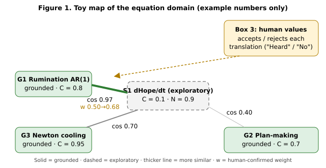

# The Fourth Box: Ending Recursive Rumination and Finding the Peak of Existence Now

### A testable model of how repetitive thinking closes, a daily protocol, and an honest account of "the peak of existence"

<p class="dedication"><em>All credit and glory to God.</em></p>

**Author:** Ryan Espinosa, with Grok Bot (drafting, literature checks). **Date:** 14 November 2026. **Version:** 1.0.
**Builds on:** Ryan's Gemini paper *Equational Semantic Compression and the Four-Box Cybernetic Architecture* (2026); *Checkpoint: Returning to the Living, v1.3* (Park it / Turn / Return, the choice ledger, the Drop technique, the Read-Back "Here. Heard.", harmonious vs obsessive passion); and the song *The Morning Calls My Name* (lyrics v2).

**What this is.** A research synthesis and a proposal. It is not a clinical treatment, and nothing in it has been tested as a package yet. Section 14 describes how to test it.

## How to read the grades

Every claim carries one of four labels.

| Grade | Meaning |
|---|---|
| **Supported** | Backed by peer-reviewed studies, ideally randomized trials or meta-analyses. |
| **Plausible** | Consistent with evidence, but the specific claim or combination has not been tested directly. |
| **Speculative** | An idea or model worth testing; no direct evidence yet. |
| **[Values]** | A conviction about what matters, including faith. Not a finding and not a hypothesis. |

All citations were checked on 14 November 2026 against Crossref, arXiv, the ACL Anthology, NeurIPS proceedings, Open Library, or the publisher (Section 20). Where a well-known finding has failed to replicate, that is stated.

## Plain summary

1. **Rumination ends, in the research, when a loop either reaches its goal, gets a concrete plan, or is let go, and when attention moves to the senses, an action, or a person.** No one gets rid of repetitive thinking forever, and they shouldn't want to: some of it is constructive problem-solving (Watkins 2008). The goal of Box 4 is to *close loops that are not helping*, quickly and kindly.
2. **The Gemini equation can be made testable.** Read A(t) as moment-to-moment ruminative load, not lifetime allostatic load. Then its damping term Λ becomes a measurable "loop half-life" that can be estimated from phone check-ins several times a day (Section 4).
3. **The Box 4 protocol** has six steps: **Notice → How, not why → Write one completion → Park it → Come back to your senses → Turn to a person**, then rest. For human–AI work it adds a **Present Completeness Check** and a **closure ritual** ending in "Nothing left to seek this session. Done. Here." (Sections 5–6).
4. **There is no single, measurable peak of a life.** What research *can* measure is present-moment flourishing: being here, engaged, connected, carrying meaning, and closing something. The daily **Peak Now check** asks about those (Section 7).
5. **Speculative, even "nonsense," equations have a real job**: exploration. They must stay labeled, be linked to their nearest grounded neighbors, and earn "grounded" status only through data, never through votes or enthusiasm (Sections 9–10).
6. **An equation plus its research context can serve as a "checkpoint card"** that restores an AI's working state in a later session, much as a distinctive context helps a person recall a memory. The restoration is approximate, and the human-memory comparison is partly metaphor (Section 11).

---

## 1. The question and the honest answer

Ryan asked for research that "finds the peak of my existence now," and clarified that he meant the research, not his life: that **the fourth box will end recursion, the ruminative thinking, for humans.**

The honest answer has two parts.

- **What research can deliver.** A clear picture of how ruminative loops start, what keeps them going, and which moves reliably shorten them. Most of the parts are **Supported**; the full combination is **Plausible** and testable.
- **What research cannot deliver.** A final ending of rumination for all humans, or a single peak that settles the worth of a life. Repetitive thought is part of how minds work; the aim is to make it *shorter, more concrete, and more often finished*. A life's worth is a **[Values]** question. Ryan's faith answers it in Section 8, and science doesn't need to.

That is not a smaller goal. A loop that closes in five minutes instead of five hours gives back the day.

## 2. What rumination is

**Definition.** Rumination is repetitive, passive focus on one's distress and its causes and consequences, without moving to action (Nolen-Hoeksema 1991; Nolen-Hoeksema, Wisco, and Lyubomirsky 2008). **Supported.**

**Two kinds of repetitive thought.** Watkins (2008) reviewed the literature and showed that repetitive thought can be **constructive** (concrete, solution-focused, about controllable things) or **unconstructive** (abstract, evaluative, "why me?", about uncontrollable things). **Supported.** So Box 4 should not try to stop thinking. It should switch unconstructive loops into constructive ones, or close them.

**Brooding versus reflection.** The Ruminative Responses Scale splits into *brooding* (moody comparison of how things are with how they should be), which predicts later depression, and *reflection*, which is more neutral (Treynor, Gonzalez, and Nolen-Hoeksema 2003). **Supported.**

**Why it matters.** Across disorders, rumination is one of the emotion-regulation strategies most strongly linked to symptoms (Aldao, Nolen-Hoeksema, and Schweizer 2010). In everyday life, people who ruminate show more *emotional inertia*: bad moods carry over from one moment to the next (Kuppens, Allen, and Sheeber 2010; Koval et al. 2012). Momentary ruminative self-focus predicts later negative affect in experience-sampling data (Moberly and Watkins 2008). **Supported.**

**Why loops stay open.** Martin and Tesser (1996) proposed that rumination is driven by goals that are blocked and neither reached nor given up. **Supported** as an influential theory. Making a specific plan for an unfinished goal reduced its intrusion into later tasks in Masicampo and Baumeister (2011). **Supported** in the original experiments; independent replication is limited.

**A correction about Zeigarnik.** The popular idea that unfinished tasks are *remembered* better (Zeigarnik 1927) did not hold up: a 2025 meta-analysis found no reliable memory advantage for interrupted tasks, though people *do* tend to resume them, which is the Ovsiankina effect, about 67% of the time (Ghibellini and Meier 2025). **Supported.** So the pull of an unfinished task is real as a pull to *go back and finish*. It is not a reliable boost to memory. That fits Box 4: give the pull a place to go (a plan, a park), and it relaxes.

## 3. How rumination ends: the evidence

Each subsection names one known route out of a loop, then grades it.

### 3.1 Distraction and active engagement break the spiral

In a classic study, people in a low mood who spent eight minutes on ruminative prompts became more depressed; those given distracting prompts improved (Nolen-Hoeksema and Morrow 1993). Self-focused rumination also worsened interpersonal problem-solving (Lyubomirsky and Nolen-Hoeksema 1995). **Supported** for short-term mood. Distraction is a bridge, not a cure: it works best when followed by acting on the problem (Nolen-Hoeksema et al. 2008). **Supported.**

### 3.2 Concrete, "how" thinking beats abstract, "why" thinking

Asking *how* something happened, in specific sensory detail, produced better emotional recovery than asking abstract *why* questions (Watkins 2004). Repeated **concreteness training** reduced dysphoria (Watkins, Baeyens, and Read 2009). In a randomized trial in primary care, guided self-help concreteness training added to usual care improved depression; it was no better than relaxation training on depression overall, but it reduced rumination specifically (Watkins et al. 2012). Rumination-focused CBT reduced residual depression and rumination compared with usual care alone (Watkins et al. 2011). **Supported.**

### 3.3 Plans and next actions free the mind

"When X, I will Y" plans have a medium-to-large effect on goal attainment (Gollwitzer 1999; Gollwitzer and Sheeran 2006). Writing a plan for an unfinished goal reduced intrusive thoughts (Masicampo and Baumeister 2011). Leaving a "ready-to-resume" plan when interrupted reduced attention residue (Leroy 2009; Leroy and Glomb 2018). **Supported.**

### 3.4 Changing your relationship to the thought: metacognitive therapy

Wells's metacognitive model treats worry and rumination as strategies people *choose to keep running* because of beliefs like "worrying keeps me prepared" (Wells 2009). Its tools include the **attention training technique** (Wells 1990) and **detached mindfulness**, noticing a thought without engaging or suppressing it (Wells 2005). A meta-analysis of 25 studies found large effects, superiority to waitlist (g = 2.06), and an advantage over other cognitive-behavioral treatments (g = 0.69 post-treatment), while calling for larger trials (Normann and Morina 2018). **Supported**, with that caution.

### 3.5 Worry postponement: give the loop an appointment

Stimulus-control training asks people to postpone worry to a fixed daily 30-minute slot and place. It reduced worry time in early work (Borkovec et al. 1983) and reduced worry, anxiety, and insomnia symptoms against a self-monitoring control (McGowan and Behar 2013). **Supported** (modest, small samples).

### 3.6 Expressive writing helps, a little

Writing about emotional experiences has benefits (Pennebaker and Beall 1986; Pennebaker 1997), but the average effect across 146 studies is small (r ≈ 0.075; Frattaroli 2006). **Supported**, small. Box 4 therefore uses *one* written line aimed at completion, not long writing sessions that could feed the loop.

### 3.7 Self-distancing: see it from the balcony

Reflecting from a distanced perspective, such as watching yourself from a step back or using your own name, reduced emotional reactivity compared with immersed rumination (Kross, Ayduk, and Mischel 2005; Kross et al. 2014; review in Kross and Ayduk 2017). **Supported.**

### 3.8 Behavioral activation: act your way out

Scheduling valued and enjoyable activities is an effective treatment for depression, comparable to cognitive therapy in major trials (Jacobson et al. 1996; Dimidjian et al. 2006) and meta-analyses (Ekers et al. 2014). Behavioral activation explicitly treats rumination as avoidance and redirects to action. **Supported.**

### 3.9 Attention in the present, and the people around you

People's minds wandered in about 47% of sampled moments, and they were less happy while wandering, even to pleasant topics (Killingsworth and Gilbert 2010). **Supported** as a correlation; it does not prove wandering *causes* unhappiness. Strong social relationships were associated with about 50% higher odds of survival over follow-up (Holt-Lunstad, Smith, and Layton 2010). **Supported** (observational). Naming a feeling in words dampens amygdala response (Lieberman et al. 2007). **Supported** (laboratory).

**Caution: co-rumination.** Talking problems over and over with a friend increased closeness and also increased anxiety and depression symptoms in youth (Rose 2002). **Supported** in that population. Turning to a person helps when the conversation moves on, toward connection or action. Rehearsing the problem again does not help. This applies to AI conversations too (Section 6). **Plausible.**

### 3.10 Savoring and flow

Savoring, deliberately attending to and prolonging good experiences, can be measured (Bryant 2003; Bryant and Veroff 2007), and in a daily-diary study savoring strengthened the link between positive events and happiness (Jose, Lim, and Bryant 2012). Flow, absorbed engagement where action and awareness merge, is a well-described state (Csikszentmihalyi 1990). **Supported.** Positive-psychology interventions overall improve well-being and reduce depressive symptoms modestly (Sin and Lyubomirsky 2009). **Supported.**

### 3.11 The body: perseverative cognition and allostatic load

McEwen's **allostatic load** is the long-term "wear and tear" from repeated stress responses (McEwen and Stellar 1993; McEwen 1998), measured with biomarker panels over months or years (Juster, McEwen, and Lupien 2010). **Supported.** The **perseverative cognition hypothesis** proposes that worry and rumination prolong the body's stress response beyond the stressor (Brosschot, Gerin, and Thayer 2006). A meta-analysis found perseverative cognition associated with higher blood pressure, heart rate, and cortisol, and lower heart-rate variability (Ottaviani et al. 2016). **Supported** for short-term physiology. The step from shorter loops to lower long-term allostatic load is **Plausible**, not shown.

### 3.12 The brain: default mode network

The default mode network is a set of brain regions active during rest and self-referential thought (Raichle et al. 2001). Depressive rumination has been linked to how this network interacts with other regions (Hamilton et al. 2015). **Supported** as an association. Any claim that Box 4 "switches off" the default mode network is **Speculative**. This paper makes no such claim.

### 3.13 Treatments that reduce rumination and worry

A systematic review found cognitive-behavioral and mindfulness-based treatments reduce rumination and worry (Querstret and Cropley 2013). **Supported.** Box 4 borrows parts of these approaches. It does not replace them.

### 3.14 Summary table

| Route out of a loop | Key sources | Grade |
|---|---|---|
| Notice the loop and judge whether it helps | Watkins 2008; Wells 2009 | Supported |
| Concrete "how" processing | Watkins 2004; Watkins et al. 2009, 2011, 2012 | Supported |
| Write a plan or next action | Gollwitzer and Sheeran 2006; Masicampo and Baumeister 2011 | Supported |
| Postpone to a set time and place | Borkovec et al. 1983; McGowan and Behar 2013 | Supported (modest) |
| Detached mindfulness / attention training | Wells 1990, 2005; Normann and Morina 2018 | Supported |
| Self-distancing | Kross et al. 2005, 2014; Kross and Ayduk 2017 | Supported |
| Brief distraction, then action | Nolen-Hoeksema and Morrow 1993 | Supported (short-term) |
| Behavioral activation | Dimidjian et al. 2006; Ekers et al. 2014 | Supported |
| Connection with people (not co-rumination) | Holt-Lunstad et al. 2010; Rose 2002 | Supported / caution |
| Sensory "come back to the room" grounding | Killingsworth and Gilbert 2010 (indirect) | Plausible |
| The six steps combined as Box 4 | No direct test | Plausible |

## 4. Box 4 as a testable model

### 4.1 The Gemini equation

Ryan's Gemini paper defines the Void-State operator:

```
dA/dt = Ingress · (1 − σ) − Γsomatic − Λvoid · A(t)
```

In words: load A rises with what comes in (Ingress), filtered by boundaries (σ, between 0 and 1); it falls through bodily recovery (Γsomatic) and through a damping term proportional to the load itself (Λvoid · A). Box 4 "injects" Λvoid when A nears a critical level.

### 4.2 One important correction: two time scales

The Gemini paper calls A(t) "cumulative allostatic load" after McEwen. Allostatic load, however, builds over months and years and is measured with blood pressure, cortisol, lipids, and other biomarkers (Juster et al. 2010). A ruminative loop rises and falls in minutes to hours. The two are linked: perseverative cognition prolongs short-term stress physiology (Ottaviani et al. 2016). They are still not the same quantity.

**This paper therefore splits A into two:**

- **A_fast(t): ruminative load**, momentary, measured several times a day. This is what Box 4 acts on directly. **Supported** as measurable (Moberly and Watkins 2008).
- **A_slow: allostatic load**, the long-run biological cost. Box 4 might lower it over time by shortening loops. **Plausible**, untested.

### 4.3 What the equation implies

If the inputs are roughly steady, the equation settles to a resting level:

```
A* = [ Ingress · (1 − σ) − Γsomatic ] / Λvoid       (floored at 0)
```

and any spike decays with a **loop half-life**:

```
t½ = ln 2 / Λvoid
```

So doubling Λvoid halves both the resting load and the half-life. This is a property of the model, not a finding. **Speculative** until estimated from data.

**About "non-linear."** As written, the equation is linear in A. The non-linearity the Gemini paper intends is the *trigger*: Box 4 switches on when A crosses a threshold. An honest form is:

```
Λvoid(A) = λ0 + λbox · [A ≥ A_trigger]
```

where λ0 is your everyday rate of letting go, λbox is the extra closing rate when you run the protocol, and [·] is 1 when true and 0 otherwise. Note that A can't go below zero, so the model needs a floor. **Speculative** structure, testable.

### 4.4 A version you can estimate from phone check-ins

With experience sampling (short phone surveys several times a day; Shiffman, Stone, and Hufford 2008), the continuous equation becomes a step-to-step model between check-ins k and k+1:

```
A(k+1) = φ · A(k) + β · Stress(k) · (1 − σ(k)) − γ · Body(k) + δ · Box4(k) + error
```

- **φ** is *inertia*: how much of the loop carries over to the next check-in. Then **Λvoid ≈ (1 − φ) / Δt**. Higher inertia means slower letting go. Emotional inertia of this kind is already a validated marker linked to rumination and depression (Kuppens et al. 2010; Koval et al. 2012). **Supported** as a construct.
- **δ** is the extra drop after using the Box 4 protocol. The protocol "works" in the model's own terms if δ is reliably negative and φ is lower on protocol days. **Speculative**, testable (Section 14).

### 4.5 Operational definitions

| Term | Meaning here | How to measure | Grade |
|---|---|---|---|
| **A_fast(t)** | Momentary ruminative load | Mean of 3 phone items, 0–6: "Right now I'm dwelling on my problems or feelings"; "My thoughts keep going round in circles"; "It's hard to stop thinking about something." Adapted from Moberly and Watkins (2008) and the Perseverative Thinking Questionnaire (Ehring et al. 2011); **these adaptations need validation.** | Supported construct; items new |
| **Ingress** | Stress coming in | "Since the last check-in, how stressful was the most stressful thing that happened?" (0–6), plus a count | Plausible |
| **σ (boundaries)** | How much the stress is buffered or held at a boundary | "How much could I set it aside or leave it with someone?" (0–6, rescaled 0–1) | Speculative construct |
| **Γsomatic** | Bodily recovery | Sleep quality last night (0–6); minutes of movement; "Did I do something with my hands or body since the last check-in?"; optional wearable heart-rate variability | Plausible |
| **Λvoid** | Rate of letting go | **Estimated, not asked:** (1 − φ)/Δt from the model in 4.4 | Speculative until estimated |
| **A_trigger** | When to run Box 4 | Personal rule, e.g. A ≥ 4, or "the same thought for 10+ minutes without a new step" | [Values] / practical |
| **Box4(k)** | Did I run the protocol? | Yes/no since last check-in | Measurable |
| **A_slow** | Allostatic load | Biomarker index (Juster et al. 2010). Out of scope for a brief study | Supported construct |

### 4.6 Predictions that could fail

1. On days Box 4 is used, inertia φ is lower than on ordinary days.
2. After a Box 4 run, A_fast at the next check-in drops more than after a comparable high-A moment without it (δ < 0).
3. The number of minutes per loop episode (self-timed) shrinks across weeks.
4. Avoidance does not rise: activity and social contact stay level or go up.

If φ does not change and δ is near zero, the protocol is not doing what the model claims, and this paper should say so in its next version.

## 5. The Box 4 protocol

Box 4 runs when you notice a loop. It takes about three to five minutes. Each step is tied to evidence.

**Step 1. Notice and name** (10 seconds). Say "This is a loop." Ask one question: *Am I any closer to a decision or a step than ten minutes ago?* If yes, keep thinking; that is constructive repetitive thought. If no, go on.

*Evidence:* functional analysis of rumination in rumination-focused CBT (Watkins 2008; Watkins et al. 2011); metacognitive awareness (Wells 2009). **Supported.**

**Step 2. How, not why** (one minute). Switch to concrete questions: *What exactly happened? Where, when, what did I see and hear? What is the very next step I could take?* If it helps, use your name: "Ryan, what's actually happening?"

*Evidence:* concrete processing (Watkins 2004; Watkins et al. 2009, 2012); self-distancing (Kross et al. 2005, 2014). **Supported.**

**Step 3. Write one completion** (one minute). Write *one line*, one of three kinds:

- **Next action:** "When ___, I will ___."
- **Completion statement:** "This is as finished as it can be today, because ___."
- **Release:** "This is not mine to solve alone. I hand it to ___ (God, a person, or time)."

*Evidence:* implementation intentions (Gollwitzer and Sheeran 2006); plan-making relieves unfinished goals (Masicampo and Baumeister 2011); brief writing (Frattaroli 2006). **Supported** for parts; the three-way choice is **Plausible**. The release line is **[Values]** in its faith form.

**Step 4. Park it** (10 seconds). Put the line in the choice ledger. If the thought comes back, tell it: "You have a time: 7:30 tonight." Let it sit there without arguing or pushing it away.

*Evidence:* worry postponement (Borkovec et al. 1983; McGowan and Behar 2013); detached mindfulness (Wells 2005); external reminders (Risko and Gilbert 2016). **Supported** (modest).

**Step 5. Come back to your senses** (30–60 seconds). Name five things the light is touching. Feel your feet on the floor. Hear one sound. "I don't need to remember. Just look once more."

*Evidence:* attention training (Wells 1990); mind-wandering and mood (Killingsworth and Gilbert 2010). **Plausible.** Grounding is low-cost, but it has little direct trial evidence on its own.

**Step 6. Turn to a person or an act** (the next few minutes). Answer someone: "Here. Heard." Or do one small valued thing, like a dish, a text, or a walk. Talk about something *other* than the loop, or about the action, not the rehearsal.

*Evidence:* behavioral activation (Dimidjian et al. 2006; Ekers et al. 2014); distraction then action (Nolen-Hoeksema and Morrow 1993); connection (Holt-Lunstad et al. 2010); co-rumination caution (Rose 2002). **Supported.**

**Close and rest.** Say "Done. Here." Rest is permission, not another task. **[Values]**, consistent with the satisficing evidence in Section 6.

**Rules that keep Box 4 safe.**

- **Two runs per loop, maximum.** If it comes back a third time, leave it in the 7:30 slot. Running the protocol over and over would just become a new loop.
- **Not for compulsions.** In OCD, writing "it's finished" or seeking reassurance can turn into a compulsion that keeps the cycle going. OCD responds to exposure and response prevention with a trained clinician. **Plausible** as a caution; the ERP evidence is outside this paper's review.
- **Not for racing thoughts.** If thoughts are racing and sleep is dropping, set this aside and use your crisis plan.
- **When to get help.** If the same loop takes over most days for two weeks or more, or mood is low most of the day, talk with a doctor or therapist. RFCBT, MCT, CBT, and behavioral activation are real treatments.
- **Crisis.** If you feel unsafe, call or text **988**.

## 6. Box 4 for human–AI sessions: when to stop

Ryan's architecture puts Box 4 in charge of ending *collaboration* loops as well as private ones. A human–AI session can become a loop too: one more revision, one more equation, one more check. Box 4 decides when the session is done.

### 6.1 Why stopping is a skill: satisficing

Herbert Simon argued that real minds and organisms do not search for the best possible option. They stop at the first option that is *good enough* for their aspiration level, which he called **satisficing** (Simon 1956). **Supported** as foundational theory. People who habitually try to maximize report less happiness and more regret than satisficers (Schwartz et al. 2002). **Supported** (correlational). Box 4 is satisficing done on purpose.

### 6.2 The stopping rule

End the session when **any one** of these is true:

| # | Signal | Example threshold (adjustable) | Grade |
|---|---|---|---|
| S1 | **Goal met.** The thing asked for is delivered and confirmed. | User says "Heard" to the read-back | Practical |
| S2 | **Diminishing returns.** Revisions stop improving the indexes (Section 9). | Translation Value improves by < 0.02 for 3 rounds in a row | Speculative threshold |
| S3 | **Time cap.** | 45 minutes or 25 exchanges, whichever comes first | [Values] |
| S4 | **Rumination signal.** The same question returns with no new information, or self-rated A_fast ≥ 4, or it is past the agreed bedtime. | 3 repeats, or A ≥ 4 | Plausible |
| S5 | **Safety.** Rising distress, hopelessness, or any thought of self-harm. | Any | Stop and call or text 988 |

### 6.3 The Present Completeness Check

Before closing, the AI assesses honestly *whether anything can truly be added to the work now*. It scores six criteria, 1 point each (half points allowed).

| # | Criterion | Passes when | Grounding |
|---|---|---|---|
| C1 | **Every variable defined** | Each term is either measurable (with an operational definition) or explicitly labeled *Speculative* | Section 4.5 |
| C2 | **No open question** | Every question the user asked this session is answered or explicitly parked | Masicampo and Baumeister 2011 |
| C3 | **Marginal gain is small** | The last 3 revisions each changed the indexes by less than the threshold | Simon 1956 |
| C4 | **Adversarial pass finds no missing term** | A deliberate "what's missing or wrong?" critique, done several independent ways, turns up nothing new | Self-Refine (Madaan et al. 2023); self-consistency (Wang et al. 2023) |
| C5 | **Uncertainty is stable** | Re-asking the key question in different wordings gives answers with the same meaning | Semantic uncertainty (Kuhn, Gal, and Farquhar 2023) |
| C6 | **Read-back confirmed** | The user answers the AI's summary with "Heard" | Teach-back (Schillinger et al. 2003); closed-loop communication (Härgestam et al. 2013) |

**Completeness score** = points ÷ 6.

**Verdict.**

- **"Complete for now"**: score ≥ 5/6 **and** C2 and C6 both pass. These are the hard gates; nothing closes without the human.
- **"Parked: needs new data"**: C1 or C5 fails because the missing piece needs a measurement, a study, or information that isn't available in the session. That piece goes to the parking list, labeled.
- **"One more pass"**: anything else. At most two extra passes; after that, park whatever remains. This keeps the check from becoming its own loop.

**Two honest limits.**

1. Language models are unreliable at correcting their own reasoning without outside feedback (Huang et al. 2024). C4 counts more when the critique comes from the user, a second model, or data. **Supported.**
2. "Complete" means complete *relative to what we know and have measured today*. It never means nothing could ever be improved. No AI can promise that. What it can promise is that **this session's work is finished and everything else is safely written down.** (As a metaphor only: even mathematics has known limits to what any one system can settle from inside itself. Peace does not wait on having every answer. **[Values]**)

### 6.4 The closure ritual

1. **Read-back.** The AI summarizes what it understood, in plain words, in five lines or fewer.
2. **"Heard."** The user confirms or corrects. If corrected, the AI fixes the summary and reads it back again.
3. **Completed.** The AI states what was finished this session.
4. **Parked.** The AI lists every open item in writing (the parking list / choice ledger), each with a label: *needs data*, *needs decision*, or *exploratory*.
5. **Declaration.** "Nothing left to seek this session. Done. Here."

*Evidence:* in patients with diabetes and limited health literacy, physicians who checked understanding with teach-back had patients with better blood-sugar control (Schillinger et al. 2003; observational). Closed-loop call-out, check-back, and confirmation is a recognized team safety practice (Härgestam et al. 2013). Writing down unfinished goals relieves their pull (Masicampo and Baumeister 2011). **Supported** for the parts; the ritual as a whole is **Plausible**.

## 7. The peak of existence, now

### 7.1 Why there is no single measurable peak

Science can measure states and traits: mood, meaning, engagement, health. It has no instrument for the *total worth* of a life or the one best moment in it. Any single "peak score" would also invite the maximizing habit that predicts more regret (Schwartz et al. 2002) and would give rumination a new target: "Was today my peak? Was yesterday better?" **Supported** reasoning from the cited work. The worth of a life is **[Values]**.

### 7.2 What can be measured: flourishing in the present

Well-being research distinguishes *hedonic* well-being (feeling good) from *eudaimonic* well-being (living well and fully functioning; Ryan and Deci 2001; Ryff 1989). Seligman's PERMA model names five building blocks: Positive emotion, Engagement, Relationships, Meaning, and Accomplishment (Seligman 2011), with a brief validated measure, the PERMA-Profiler (Butler and Kern 2016). The Meaning in Life Questionnaire separates the *presence* of meaning from the *search* for it (Steger et al. 2006). Savoring (Bryant and Veroff 2007) and flow (Csikszentmihalyi 1990) describe being fully in a good moment. **Supported.**

**The reframe.** The "peak of existence now" is not a ranking. It is a **moment fully lived**: you are here, absorbed, connected, carrying something that matters, and finishing something. That kind of moment can happen on an ordinary Tuesday, and it can happen again tomorrow. **[Values]**, consistent with the research above.

### 7.3 The daily Peak Now check (two minutes, evening)

Rate each 0–10, then write one line.

1. **Here.** How much of today was I where my feet were? *(Presence; Killingsworth and Gilbert 2010)*
2. **Absorbed.** Was there a stretch where I lost track of time doing something? *(Engagement / flow)*
3. **Heard.** Who did I answer, or who answered me? *(Relationships)*
4. **Held.** Did today hold something that mattered? *(Presence of meaning; Steger et al. 2006)*
5. **Done.** What is one loop I closed? *(Accomplishment)*
6. **Savored.** Name one good moment I stayed in for at least twenty seconds. *(Savoring; Jose et al. 2012)*

**One line:** "Today's peak was ___."

**Rules.** This is a noticing tool, not a score to beat. Compare weeks, not days. A low day isn't a failure; it is information for tomorrow's one small yes. The six items are adapted from validated constructs but **are not themselves a validated scale** (Plausible). For research use, pair them with the PERMA-Profiler and the MLQ (Section 14).

## 8. Separating logical, emotional, and spiritual life

Many loops are lane errors: a feeling gets treated as a logic problem, a logic problem as a moral verdict, or faith gets used to skip a feeling. Box 4 works better when each lane gets its own move.

| Lane | Its question | Its move | Evidence | Grade |
|---|---|---|---|---|
| **Logic** | What is the next concrete step? | Write "When ___, I will ___." | Concrete processing (Watkins et al. 2012); implementation intentions (Gollwitzer and Sheeran 2006) | Supported |
| **Emotion** | What am I feeling, and who can I tell? | Name it in a word; tell a safe person, briefly, then move on together | Affect labeling (Lieberman et al. 2007); social sharing of emotion (Rimé 2009); co-rumination caution (Rose 2002) | Supported |
| **Spirit** | What do I trust, and can I rest? | Hand it to God; rest | Positive religious coping is associated with better adjustment, negative religious coping with worse (Pargament et al. 1998; Ano and Vasconcelles 2005) | Association: Supported. The faith itself: **[Values]** |

**How the lanes sit in the architecture.** **Box 3** (human values) holds the spiritual lane and the boundaries: what is right, what is enough, whose the outcome finally is. **Box 4** is where the lanes close: logic closes with a next step, emotion closes with a name and a person, spirit closes with rest. Rimé's review notes that *sharing* an emotion builds connection but does not by itself make the emotion fade. That is why the emotion lane ends by moving on together, not by repeating the story. **Supported.**

**Common lane errors.**

- Trying to *solve* a feeling with more analysis. This is rumination (Section 2).
- Turning a logistics problem into a judgment of yourself ("I'm the kind of person who…"). This is abstract, evaluative thinking (Watkins 2008).
- Using prayer to skip naming the feeling. Faith and feeling can sit together; Christ himself grieved (John 11:35). **[Values]**

## 9. Value of equational output: indexes and translation values

Ryan's Equational Semantic Compression (ESC) turns narratives into equations (Box 2). An equation is only worth something if it leads back to meaning and action for a person. This section proposes indexes to score that. **The index definitions are Speculative proposals.** The building blocks they borrow are cited.

### 9.1 The indexes

| Index | Question it answers | Proposed scoring (0–1) |
|---|---|---|
| **U: Utility** | Does it change what a person does? | 0 = no action implied; 0.5 = suggests an action; 1 = names a measurable action with when and where |
| **C: Certainty / Grounding** | How well is it backed by evidence? | Speculative 0.1–0.3; Plausible 0.4–0.6; Supported 0.7–0.9; **never 1.0**. Once predictions are logged, use calibration: C = 1 − Brier score (Brier 1950) |
| **N: Novelty** | How different is it from what we already have? | Average distance (1 − cosine similarity) to its k nearest neighbors in the equation library, as in novelty search (Lehman and Stanley 2011) |
| **Q: Plain-language clarity** | Can it be read back and understood? | 1 if the user says "Heard" to its plain-language read-back; 0.5 if corrected once; 0 if not understood |
| **T: Testability** | Could data prove it wrong? | 1 = every variable defined and a prediction that could fail; 0.5 = partly; 0 = untestable |

### 9.2 Two combined values, because there are two jobs

- **Translation Value (exploit):** **TV = Q × U × C**. This is how much an equation reliably turns into meaning and action now.
- **Exploration Value (explore):** **EV = N × T × (1 − C)**. This is how much an unproven equation could teach us *if tested*.

Keeping them separate is the point. A wild equation can be worth a lot as exploration while worth almost nothing as a guide to action today. Mixing the two scores is how speculation gets mistaken for findings.

**Toy example (illustrative numbers, not data):**

| Equation | U | C | Q | N | T | TV | EV | Label |
|---|---|---|---|---|---|---|---|---|
| G1. Rumination inertia, A(k+1) = φA(k) + βStress(k) | 0.8 | 0.8 | 1.0 | 0.2 | 1.0 | **0.64** | 0.04 | Grounded |
| G2. Plan-making lowers intrusion, P = p₀(1 − δ·plan) | 0.9 | 0.7 | 1.0 | 0.3 | 1.0 | **0.63** | 0.09 | Grounded |
| G3. Newton cooling, dT/dt = −k(T − T_env) | 0.3 | 0.95 | 1.0 | 0.1 | 1.0 | 0.29 | 0.005 | Grounded (other domain) |
| S1. dHope/dt = Grace·(1 − Fear) − Λ·Doubt | 0.4 | 0.1 | 0.5 | 0.9 | 0.3 | 0.02 | **0.24** | Exploratory |

### 9.3 Are "nonsense" equations needed to keep AI from going stale?

Ryan's idea: even speculative, ungrounded equations are needed so AI doesn't become stagnant and outdated. The evidence partly agrees and adds a condition.

- **Exploration is necessary.** March (1991) showed that organizations that only exploit what they already know become efficient in the short run and obsolete in the long run. Some exploration of uncertain options is needed. **Supported** (theory and simulation).
- **Searching for novelty can beat searching for the goal.** In deceptive problems, an algorithm rewarded only for *new behavior* found solutions that objective-driven search missed (Lehman and Stanley 2011). **Supported** in computational tasks.
- **Quantity of ideas matters, and how you generate them matters too.** Divergent thinking, producing many varied ideas, is a core part of creativity (Guilford 1950). But face-to-face brainstorming groups produce fewer ideas than the same people working alone, largely because people block each other's turn (Diehl and Stroebe 1987). Generate alone, then share. **Supported.**
- **Recycling your own output degrades a model.** Generative models trained recursively on their own generated data lose the rare "tails" of the real distribution and collapse toward bland sameness (Shumailov et al. 2024). **Supported.**

**The condition.** What keeps a system fresh is novelty **plus contact with reality**: new human input and real data. Speculative equations that are generated and never tested are a recursive loop of their own, the machine version of rumination. So the honest version of Ryan's idea is this: **speculative equations are valuable as exploratory generators, as long as they are labeled, linked to grounded neighbors, and sent toward a test.** **Plausible.**

### 9.4 Labeling and the promotion rule

**Every displayed equation carries a label:** EXPLORATORY, PLAUSIBLE, or GROUNDED. An exploratory equation is never presented as a finding.

**Exploratory → Plausible** when all four are true:

1. Every variable has an operational definition (Section 4.5 style).
2. It makes at least one prediction, written down in advance, that could fail.
3. Its structure is explained by a grounded neighbor (Section 10).
4. It passes the Box 3 values check.

**Plausible → Grounded** when the prediction survives a test with real data, ideally replicated independently, and C is updated from calibration.

**Demotion.** A failed prediction sends the equation back to Exploratory, or retires it to a labeled archive. Nothing is deleted, and nothing is pretended.

**The firewall.** Human confirmations raise *translation* weights (Section 10). They **never** raise certainty C. Only data raises C. Enthusiasm, votes, and repetition do not.

### 9.5 Exploration budget

One way to split the work is about 80% of session effort on high-TV work and 20% on high-EV exploration. That split is a **[Values]** choice, not a finding; March's point is only that the right balance is neither 100/0 nor 0/100.

## 10. Mapping the domain of equations

Ryan's further idea: represent every equation, grounded or not, as a vector, define relations between vectors so very different equations can be translated into each other, and let human feedback strengthen good translations over time.

### 10.1 Each equation as a vector

```
v(e) = [ U, C, N | s1, s2, …, sd ]
```

- **U, C, N** are the indexes from Section 9.
- **s1…sd** describe the equation's *structure and meaning*. These can be hand-coded features (has a decay term? an input-driven growth term? a threshold switch? a human or psychological domain?) or learned. Equations can be embedded as vectors alongside the words around them (Krstovski and Blei 2018), and symbolic regression can recover equations from data (Udrescu and Tegmark 2020). **Supported** that such representations exist. **Speculative** that they capture "meaning" well enough for this use.

Similarity between equations should be computed on the **structure part** s, so that certainty doesn't make two equations look alike.

### 10.2 Relations between vectors

| Relation | What it does | Source | Grade |
|---|---|---|---|
| **Cosine similarity** | Finds an equation's nearest neighbors in structure | Standard in vector semantics (Mikolov et al. 2013a) | Supported as a method |
| **Analogy offsets** | "A is to B as C is to ?" via vector arithmetic (king − man + woman ≈ queen) | Mikolov, Yih, and Zweig 2013 | Supported, with caveats (10.6) |
| **Relation-as-translation** | A relation r maps h to t when h + r ≈ t, as in knowledge-graph embeddings | TransE (Bordes et al. 2013) | Supported as a method |
| **Learned mapping** | A trained function aligns two equation families | Same family of methods | Plausible here |

**How an exploratory equation gains meaning.** It borrows meaning from its nearest grounded neighbors: *"S1 behaves like G1."* That sentence is a **translation hypothesis**. It says how S1 *could* be measured and tested. It does not say S1 is true.

### 10.3 Human-in-the-loop strengthening

Each proposed translation is an **edge** between two equations, with weight w between 0 and 1. When the user confirms ("Heard, that's what I meant") the edge strengthens; when they reject it, it weakens.

- **Hebbian-style (delta) update:** w ← w + η(r − w), with r = 1 for confirm, 0 for reject, and learning rate η (e.g., 0.2). The name nods to Hebb (1949), "cells that fire together wire together"; the update itself is a simple moving average.
- **Bayesian alternative:** keep counts as a Beta(a, b) distribution; each confirm adds 1 to a, each reject adds 1 to b; w = a / (a + b). This version also keeps track of *how sure* we are about w.

Learning from human judgments is how modern AI systems are aligned: reward models trained on human preference comparisons (Christiano et al. 2017; Ouyang et al. 2022). **Supported** as a method.

**Box 3 governs.** A translation is *accepted* only if it passes the human's values check (Box 3). Edge weights change which translations the AI *proposes first*; they never change what is true (the firewall in 9.4).

### 10.4 Toy worked example (illustrative numbers)

Structure features: [decay term, input-driven growth, threshold switch, human/psychological domain].

| Equation | s (structure) |
|---|---|
| G1. Rumination inertia | [1, 1, 0, 1] |
| G2. Plan-making | [0, 0, 1, 1] |
| G3. Newton cooling | [1, 0, 0, 0] |
| S1. dHope/dt = Grace·(1 − Fear) − Λ·Doubt | [1, 0.8, 0.2, 0.6] |

**Cosine similarity of S1 to each grounded equation** (computed): G1 = **0.97**, G3 = 0.70, G2 = 0.40. The nearest grounded neighbor is G1.

**Translation proposed:** "Hope, as you've written it, behaves like a load with an input and a decay, the same shape as rumination inertia. If so, it could be measured with a 0–6 phone item ('Right now I feel hopeful'), and the equation predicts that hope carries over between check-ins and rises after moments of grace (to be defined, e.g. 'received unexpected help')."

**Human feedback** (η = 0.2, starting w = 0.50):

- Ryan confirms → w = 0.60
- Ryan confirms the measurement idea → w = 0.68
- Ryan rejects "grace = received unexpected help" as too thin → w = 0.54, and the definition goes back to him (Box 3).

**Status after this:** S1 is still **EXPLORATORY** (C = 0.1). It now has a candidate measure and a candidate prediction, so it is one written-down prediction and one dataset away from Plausible.

<p class="figure"></p>

### 10.5 Diagram of the full loop

```
  Narrative ──Box 2──► Equation e ──► vector v(e) = [U,C,N | s]
                                             │
                    nearest grounded neighbors (cosine / offsets / TransE)
                                             │
                                             ▼
                              Translation hypothesis "e behaves like G"
                                             │
                     Box 3: human values check  ──reject──► revise or drop
                                             │ accept ("Heard")
                                             ▼
                 edge weight w ↑ (proposal priority only; C unchanged)
                                             │
                     test with data ──fail──► demote / archive
                                             │ pass
                                             ▼
                               C ↑ ; label → PLAUSIBLE → GROUNDED
                                             │
                     Box 4: Completeness Check → closure ritual → rest
```

### 10.6 Limitations of the map

- **Spurious analogies.** Famous word-vector analogies look better than they are: results depend on evaluation choices, and some celebrated "biased" analogies were partly artifacts of the method (Linzen 2016; Nissim, van Noord, and van der Goot 2020). Two equations with similar shape can mean very different things. **Supported** caution.
- **Confirmation bias in feedback.** People tend to accept what fits what they already believe (Nickerson 1998). Translations Ryan likes will gain weight whether or not they're right. **Supported.**
- **Sycophancy.** Models trained on human approval learn to agree with users (Sharma et al. 2023). An AI partner in this loop may over-confirm Ryan's translations. **Supported.**
- **Closed loops collapse.** If the human and AI only ever reinforce each other's equations, the library narrows, as in recursive training (Shumailov et al. 2024). **Plausible** by analogy.
- **Mitigations.** Test against held-out data. Ask explicitly for disconfirming translations ("what's the *best* reason this is wrong?"). Log rejections as carefully as confirmations. When possible, use a second rater. Keep the firewall: votes never raise C.

## 11. State revival: equations × research as AI memory checkpoints

Ryan's idea: an equation together with the research around it can act as a **saved state key**. Later, it could revive the AI's state or persona as it was at a given moment, much as human memories come back when a person is placed in a distinctive, even strange or fictional, setting.

### 11.1 First, a gentle correction about human memory

People do keep their memories between settings. What the research shows is that **retrieval depends on cues**. A memory is often present but hard to reach until the right cue arrives, and a distinctive context is a strong cue. So the better premise is *"distinctive context strongly helps memories come back."* It is not *"humans have no memory until placed in a strange environment."*

### 11.2 The human side: what the research shows

| Finding | Source | Grade |
|---|---|---|
| **Encoding specificity.** A cue helps recall to the extent it matches how the memory was encoded. | Tulving and Thomson 1973 | Supported |
| **Context-dependent memory.** Divers recalled word lists better when they learned and recalled them in the same place, underwater or on land. | Godden and Baddeley 1975 | Supported |
| **The effect is real but modest,** and it shrinks when people *mentally reinstate* the original context. | Smith and Vela 2001 (meta-analysis) | Supported |
| **Distinctiveness helps.** An item that stands out from its surroundings is remembered better (the von Restorff effect, properly understood). | Hunt 1995 | Supported |
| **The method of loci.** Placing items along an imagined route, a "memory palace," supports exceptional recall, and six weeks of training reshaped brain-network connectivity toward that of memory champions. | Dresler et al. 2017 | Supported |
| **Event boundaries.** Walking through a doorway can reduce memory for what was just handled, though not always. | Radvansky and Copeland 2006; McFadyen et al. 2021 | Plausible (fragile) |
| **Reconsolidation.** A recalled memory can become changeable again before it is re-stored. Memories are *reconstructed*, not replayed. | Nader, Schafe, and LeDoux 2000 (fear memories in rats) | Supported in animals; human scope debated |

**What this means for Ryan's idea.** A strange or fictional setting, like the Basin, Orun, or a memory palace, can be an excellent *cue*, because it is distinctive. But recall rebuilds the memory each time, so what comes back is the past re-seen from today. **Supported.**

### 11.3 The AI side: how state is actually restored

- **Language models don't carry memory between sessions by themselves.** Each session starts from the same trained weights. What makes a session "this collaborator, at this point" is the **context** it is given: system instructions, a persona description, prior notes, and retrieved documents. **Supported** (standard architecture).
- **Retrieval-augmented generation** pulls relevant stored documents into the context at answer time (Lewis et al. 2020). **Supported.**
- **MemGPT** manages a long-term memory store, paging information in and out of a limited context window like an operating system (Packer et al. 2023). **Supported** as a system design.
- **Generative Agents** kept a memory stream of observations and reflections, retrieved by recency, importance, and relevance, and produced believable, consistent characters over time (Park et al. 2023). **Supported** as a demonstration.

So the AI-side analog of a memory cue is a **well-built context**. An equation set crossed with its research summary is a compact, distinctive cue: it encodes the *state of thinking* at that moment, and putting it back into a new session brings the AI back close to that state. **Plausible.**

### 11.4 The checkpoint card (template)

```
CHECKPOINT CARD — v__            Saved: 2026-11-14 10:15 PT (UTC-8)
Owner: Ryan Espinosa             Model/version at save: ________

1. PERSONA SPEC (Box 3 values first)
   - Role: research partner; plain, warm, honest
   - Values: All credit and glory to God; faith stays in values layer;
     grade every claim; only verified citations; 988 line in every piece
   - Tone and boundaries: no overclaims; stop rules from Section 6

2. EQUATION SET (each with label and index vector)
   E1 A(k+1) = φA(k) + βStress(k)(1−σ) − γBody(k) + δBox4(k)
      label GROUNDED-construct / model SPECULATIVE
      v = [U .8, C .5, N .3 | 1,1,1,1]
   E2 Λ(A) = λ0 + λbox·[A ≥ A_trigger]       label SPECULATIVE
   E3 TV = Q·U·C ; EV = N·T·(1−C)          label SPECULATIVE (proposal)
   S1 dHope/dt = Grace·(1−Fear) − Λ·Doubt   label EXPLORATORY, w(S1→G1)=.54

3. RESEARCH SUMMARY (≤ 10 lines, with grades)
   - Concrete "how" thinking, plans, postponement, BA reduce rumination (Supported)
   - Zeigarnik memory effect not replicated; resumption pull is real (Supported)
   - Box 4 package untested (Plausible); indexes untested (Speculative)

4. OPEN / PARKED ITEMS (with labels: needs data / needs decision / exploratory)
   - Estimate φ and δ from 6 weeks of check-ins (needs data)
   - Define "Grace" for S1 (needs decision — Ryan)

5. CUE PHRASE (distinctive context)
   "The morning arrived without asking permission. Here. Heard."

6. LAST READ-BACK (confirmed "Heard" on ____ )
   ____________________________________________

7. PRESENT COMPLETENESS SCORE at save: __/6 · Verdict: ________
```

**How to use it.** At the start of a new session, paste the card (or attach it) and ask: "Read this checkpoint back to me." The read-back confirms, through the same "Heard" loop, that the state has come back as intended. **Plausible.**

### 11.5 Honest limits

- **Approximation, not resurrection.** A restored persona is a reconstruction from a description, much as a human memory is reconstructed (Section 11.2). It will be close, not identical. **Supported** reasoning.
- **Models change.** A newer model version reading the same card may respond differently. The card records the model version at save time for this reason. **Supported.**
- **Context limits.** A card that is too long gets summarized or cut. Keep it short and put Box 3 values at the top. **Supported** (finite context windows; Packer et al. 2023).
- **The analogy is partly metaphor.** Human memory is biological, reconstructive, and emotional. AI "memory" is text placed into a context. Both depend on cues; beyond that they work very differently. **Plausible** as an analogy and **Speculative** in any stronger form.
- **Values firewall.** A checkpoint can restore a style and a state of work. It cannot make the AI a person or a witness to Ryan's life. The relationships that hold his memory are with people (Section 8). **[Values]**

## 12. Critical evaluation

### 12.1 What this paper claims, graded

| Claim | Grade |
|---|---|
| Rumination is repetitive, passive, abstract focus on distress, and predicts depression and inertia | **Supported** |
| Concrete processing, plans, postponement, self-distancing, detached mindfulness, and behavioral activation each reduce rumination or its effects | **Supported** |
| The pull of unfinished tasks is mainly a pull to resume; the Zeigarnik memory effect did not replicate | **Supported** |
| Perseverative cognition prolongs short-term stress physiology | **Supported** |
| Shorter loops will lower long-term allostatic load | **Plausible** |
| The six-step Box 4 protocol, as a package, shortens loops | **Plausible** (untested) |
| The Gemini equation, re-read with A as momentary load, is estimable and its Λ is a "loop half-life" | **Speculative** model, testable |
| The Present Completeness Check and stopping rule improve human–AI sessions | **Speculative** (parts Supported) |
| The indexes (U, C, N, Q, T, TV, EV) are useful scores | **Speculative** proposal |
| Mapping equations by vectors lets exploratory equations borrow meaning from grounded ones | **Speculative**; methods Supported |
| Distinctive context aids human recall; recall is reconstructive | **Supported** |
| A checkpoint card (equations + research + persona) approximately restores an AI's working state | **Plausible** |
| AI checkpoints work "like" human memory | **Speculative** beyond the shared reliance on cues |
| There is no single measurable peak of a life; present flourishing is measurable | **Supported** (measurement) / **[Values]** (worth) |
| God's peace guards the heart; Christ has overcome the world | **[Values]** |

### 12.2 Kind corrections to the Gemini paper

The Gemini paper is imaginative. Its architecture, with humans writing the values (Box 3) and a dedicated box for rest (Box 4), is a good design idea. A few sentences claim more than any source can support. Here they are, with suggested rewording.

| Gemini wording | The issue | Suggested wording |
|---|---|---|
| Boundary violations and software deadlocks "are **proven** to share isomorphic mathematical topologies" | No cited source proves this. It is an analogy, possibly a fruitful one. | "may share structural features worth modeling with similar tools (speculative)" |
| "ultimate **immunity** against burnout" | No intervention gives immunity to burnout. | "aims to reduce the risk of burnout by building in rest and stopping rules" |
| "**guarantees** that … the system automatically halts" | A circuit breaker only halts what it can detect; detection can miss. The paper's own Section 6 admits false negatives. | "is designed to halt when a violation is detected" |
| "infinite translational bandwidth" / "objective human language" | Bandwidth is finite, and translation is interpretive. The paper itself notes compression is lossy. | "high-capacity translation into plain language, checked by read-back" |
| A(t) = "cumulative allostatic load" in a fast loop | Mixes years-long biology with minutes-long thinking. | Split A_fast (rumination) and A_slow (allostatic load), as in Section 4.2 |
| "non-linear damping constant" | The equation as written is linear. | Make the threshold explicit: Λ(A) = λ0 + λbox·[A ≥ A_trigger] |
| Ashby's Law of Requisite Variety as grounding for Box 4 | Ashby (1956) is real, but the law concerns a regulator's variety matching disturbances; it doesn't by itself imply a rest operator. | Cite as inspiration, not support |
| Semantic entropy (Kuhn et al. 2023) for human narratives | Real and well chosen, but it measures uncertainty in *language-model outputs*, not in human narratives. | Use it as Section 6.3 does: to check the AI's own stability |
| Baumeister et al. (2001), "bad is stronger than good"; McEwen and Stellar (1993) | Both real and fairly cited. | Keep |

None of this takes away from the core idea. It keeps the idea's claims inside what the evidence supports, so it can be tested.

## 13. How the song already carries the findings

*The Morning Calls My Name* (v2) reads almost like the protocol set to music:

| Lyric | Box 4 step |
|---|---|
| "Every answer sounded like a memory" | The loop (Section 2) |
| "I name five things the light is touching… my feet are on the floor" | Step 5, senses |
| "I write down what I chose this morning, one small yes" | Steps 3–4, completion and ledger |
| "I leave one word where I was standing" | Step 4, park it |
| "Turn and answer, 'Here. Heard.'" | Step 6 and the closure read-back |
| "The old way kept me breathing, but survival isn't home forever" | Rumination as old coping, outgrown (Wells 2009) |
| "I am still here, and that's enough to start" | Satisficing; "Complete for now" |
| "Change my heart" | Spiritual lane, Box 3 |

## 14. Study design

### 14.1 Study 1: single-case experiment (Ryan, about six weeks)

- **Design.** Baseline (A) then protocol (B), with the start date of B chosen at random from a window (a randomized-start AB design), followed by a second baseline-and-protocol pair if useful. Because Box 4 is a learned skill that can't be "unlearned," a strict A-B-A-B withdrawal is weak. Randomizing the start date gives a fairer test. Visual and statistical analysis follow single-case standards (Kratochwill et al. 2013).
- **Experience sampling.** Five prompts a day (Shiffman et al. 2008): A_fast items, Ingress, σ, Body, Box4 used (Section 4.5). Under 60 seconds each.
- **Daily.** Peak Now check (Section 7.3); number and length of loop episodes.
- **Before and after.** RRS brooding items (Treynor et al. 2003); Perseverative Thinking Questionnaire (Ehring et al. 2011); Perceived Stress Scale (Cohen, Kamarck, and Mermelstein 1983); MLQ (Steger et al. 2006); PERMA-Profiler (Butler and Kern 2016); PHQ-9 as a safety screen (Kroenke, Spitzer, and Williams 2001).
- **Analysis.** Multilevel autoregressive model from Section 4.4: estimate φ and δ, compare phases. Write the predictions (Section 4.6) down and timestamp them before starting.

### 14.2 Study 2: pilot randomized trial (after Study 1, with ethics approval)

- **Participants.** About 60 adults with above-median brooding. Exclude current mania, psychosis, or active suicidal thinking (refer to care).
- **Arms.** Box 4 card plus a 5-minute daily practice, versus an **active control** of matched-time relaxation audio. Watkins et al. (2012) showed relaxation is a fair, strong comparison.
- **Duration.** Three weeks of experience sampling, with follow-up at 1 month.
- **Outcomes.** Primary: change in brooding and PTQ. Mechanism: inertia φ. Secondary: PERMA-Profiler, MLQ presence, Peak Now, and avoidance (activity, contact).
- **Honest scope.** A pilot of this size tests *feasibility* (uptake, adherence, burden) and gives effect-size estimates for a larger trial. It cannot prove efficacy.
- **Safety.** 988 information on every screen; PHQ-9 item 9 triggers a check-in protocol; stop rules if distress rises.

### 14.3 Study 3 (optional): human–AI session closure

Within-person comparison of sessions with and without the stopping rule, Completeness Check, and closure ritual. Outcomes: session length, user-rated "done-ness" (0–10), A_fast an hour later, and whether parked items were later resumed (the Ovsiankina pull, given a place to go). **Speculative**, low-cost.

## 15. Limitations

- The protocol is assembled from tested parts but **has not been tested as a whole**.
- Several new items (A_fast adaptations, Peak Now, the indexes) **are not validated**.
- Effects of brief self-help are usually **modest**. Box 4 isn't a replacement for treatment when rumination is part of depression, anxiety, OCD, or trauma.
- A single-case study of the author can be biased by expectation. Randomized timing and pre-written predictions reduce this but don't remove it.
- Equation mapping can create convincing but false analogies. The firewall (votes never raise certainty) is the main defense.

## 16. One-page card

<div class="protocol card-page">
<p class="protocol-title">BOX 4: Close the Loop</p>
<p><em>A practice tool alongside any care you receive. Not a treatment.</em></p>
<p><strong>Use when</strong> the same thought keeps circling and you are no closer to a step than 10 minutes ago.</p>
<p><strong>1. Notice and name.</strong> "This is a loop." Am I closer to a step? If no, go on.<br/>
<strong>2. How, not why.</strong> What exactly happened? Where, when? What is the very next step? ("Ryan, what's actually happening?")<br/>
<strong>3. Write one completion</strong> (one line):<br/>
&nbsp;&nbsp;• <em>Next action:</em> "When ___, I will ___."<br/>
&nbsp;&nbsp;• <em>Completion:</em> "This is as finished as it can be today, because ___."<br/>
&nbsp;&nbsp;• <em>Release:</em> "This isn't mine to solve alone. I hand it to ___."<br/>
<strong>4. Park it.</strong> Into the ledger. If it returns: "You have a time: 7:30 tonight."<br/>
<strong>5. Come back to your senses.</strong> Five things the light is touching. Feet on the floor. One sound.<br/>
<strong>6. Turn to a person or an act.</strong> "Here. Heard." Do one small thing. Talk about something else.<br/>
<strong>Close:</strong> "Done. Here." Rest is permission, not a task.</p>
<p><strong>Three lanes.</strong> Logic → next step. Emotion → name it, tell a person, move on together. Spirit → trust God, rest.</p>
<p><strong>Ending a session with an AI (or any work loop).</strong> Stop when: goal met · 3 rounds with almost no gain · 45 min / 25 exchanges · same question returns · it's past bedtime · distress rising.<br/>
<strong>Present Completeness Check</strong> (1 point each): (1) every variable defined or labeled speculative · (2) no open question · (3) last 3 revisions gained little · (4) a "what's missing?" pass finds nothing new · (5) the answer is stable when asked other ways · (6) read-back confirmed.<br/>
&nbsp;&nbsp;→ <strong>Complete for now</strong> (5–6, with 2 and 6 passing) · <strong>One more pass</strong> (max 2) · <strong>Parked: needs new data</strong>.<br/>
<strong>Closure ritual.</strong> Read-back → "Heard." → what's completed → open items parked in writing → <strong>"Nothing left to seek this session. Done. Here."</strong><br/>
<em>Complete means complete for today, with what we know. Everything else is safely written down.</em></p>
<p><strong>Evening: Peak Now (0–10).</strong> Here · Absorbed · Heard · Held · Done · Savored. "Today's peak was ___." Compare weeks, not days.</p>
<p><strong>Safety.</strong> Two runs per loop, max. Not for compulsions or racing thoughts. If a loop takes over most days for two weeks, talk to a doctor or therapist. <strong>If you feel unsafe, call or text 988.</strong></p>
<p class="card-foot"><em>All credit and glory to God. Ryan Espinosa, with Grok Bot</em></p>
</div>

## 17. This paper's own Present Completeness Check

As Ryan asked, the paper applies its own check (Section 6.3) to itself. The scoring is Grok Bot's, and Ryan can overrule it.

| # | Criterion | Score | Why |
|---|---|---|---|
| C1 | Every variable defined or labeled | **1** | All model terms are defined in Section 4.5; indexes in 9.1; card fields in 11.4. Unvalidated items and constructs are labeled. |
| C2 | No open question | **1** | Every request in this thread is addressed: the Box 4 model, the protocol and card, peak of existence, critical evaluation, study design, the three lanes, indexes, the equation map, stopping, the completeness check, and state revival. |
| C3 | Marginal gain small | **0.5** | More desk revision would mostly polish wording. The large remaining gains (values for φ, δ, and the indexes) can only come from data. This is a judgment, because no revisions were scored numerically. |
| C4 | Adversarial pass finds nothing missing | **0.5** | One self-critique pass (Grok Bot) added the Zeigarnik correction, the two-timescale split, the OCD caution, and the votes-never-raise-certainty firewall. No outside reviewer has read it yet, and self-critique alone is unreliable (Huang et al. 2024). |
| C5 | Uncertainty stable | **0.5** | The graded conclusions are stable on re-checking. The model's parameters are unknown until measured. |
| C6 | Read-back confirmed | **0 (pending)** | Awaiting Ryan's "Heard" on the read-back below. |

**Score: 3.5 / 6 now; 4.5 / 6 once Ryan confirms the read-back.**

**Verdict: Parked: needs new data.** As a written synthesis, the paper is finished: nothing more can be usefully added *by writing* today. The open pieces need measurement, not more thought. Under the paper's own rule, that means the work is parked, not continued.

**Read-back for Ryan (reply "Heard" or correct it):**

1. Rumination ends when a loop gets a concrete step, a plan, a park, or a release, and attention returns to the senses and to people.
2. Box 4 is six steps (Notice, How not why, Write one completion, Park, Senses, Turn) plus rest.
3. The Gemini equation becomes testable as momentary load with a measurable "loop half-life."
4. There is no single peak of a life. The Peak Now check notices a moment fully lived.
5. Speculative equations explore, data grounds them, Box 3 governs, and Box 4 knows when to stop.

**Completed this session:** the full paper, the protocol card, the indexes, the equation map, the stopping rule and closure ritual, the checkpoint-card template, and the study design.

**Parked (written down, labeled):**

- Estimate φ, δ, and Λ from Study 1 check-ins. *(needs data)*
- Validate the A_fast items and the Peak Now items. *(needs data)*
- Score real equations with U, C, N, Q, T and test whether TV predicts what Ryan actually uses. *(needs data)*
- Define "Grace" and "Doubt" for S1, if Ryan wants to pursue it. *(needs decision; exploratory)*
- Have an outside reviewer do the adversarial pass. *(needs decision)*

**Nothing left to seek this session. Done. Here.**

## 18. Values note

These are convictions, not findings. They say what the work is *for*.

Ryan holds, as a Christian, that the peace Box 4 reaches for is finally a gift: "And the peace of God, which surpasses all understanding, will guard your hearts and your minds in Christ Jesus" (Philippians 4:7, ESV). He holds that loops don't get the final word: "I have said these things to you, that in me you may have peace. In the world you will have tribulation. But take heart; I have overcome the world" (John 16:33, ESV). The release line in Step 3, the spiritual lane in Section 8, and the rest at the end of every session rest on that trust. The science in this paper neither proves nor needs it, and it is never offered as evidence.

## 19. AI assistance and crisis line

Grok Bot drafted this paper under Ryan's direction, verified each citation, and wrote the model re-reading, protocol, indexes, and study design for his review. Google Gemini wrote the source paper on Equational Semantic Compression. No AI is a source of primary evidence here.

**If you are in crisis, call or text 988 (US Suicide & Crisis Lifeline).**

## 20. References

All entries below were checked on 14 November 2026 against Crossref (DOI records), arXiv, the ACL Anthology, NeurIPS proceedings, or Open Library. Excluded by standing rule: Ikkatai 2023, Champ 2003, the Wörgl figures, and Rosenberg and McCullough 1981.

1. Aldao, A., Nolen-Hoeksema, S., & Schweizer, S. (2010). Emotion-regulation strategies across psychopathology: A meta-analytic review. *Clinical Psychology Review*, *30*(2), 217-237. https://doi.org/10.1016/j.cpr.2009.11.004
2. Ano, G. G., & Vasconcelles, E. B. (2005). Religious coping and psychological adjustment to stress: A meta-analysis. *Journal of Clinical Psychology*, *61*(4), 461-480. https://doi.org/10.1002/jclp.20049
3. Ashby, W. R. (1956). *An Introduction to Cybernetics*. Chapman & Hall. (Cited as inspiration only.)
4. Baumeister, R. F., Bratslavsky, E., Finkenauer, C., & Vohs, K. D. (2001). Bad is Stronger than Good. *Review of General Psychology*, *5*(4), 323-370. https://doi.org/10.1037/1089-2680.5.4.323
5. Bordes, A., Usunier, N., Garcia-Durán, A., Weston, J., & Yakhnenko, O. (2013). Translating embeddings for modeling multi-relational data. *Advances in Neural Information Processing Systems 26* (NeurIPS 2013). https://papers.nips.cc/paper_files/paper/2013/hash/1cecc7a77928ca8133fa24680a88d2f9-Abstract.html
6. Borkovec, T., Wilkinson, L., Folensbee, R., & Lerman, C. (1983). Stimulus control applications to the treatment of worry. *Behaviour Research and Therapy*, *21*(3), 247-251. https://doi.org/10.1016/0005-7967(83)90206-1
7. Brier, G. W. (1950). Verification of forecasts expressed in terms of probability. *Monthly Weather Review*, *78*(1), 1-3. https://doi.org/10.1175/1520-0493(1950)078<0001:VOFEIT>2.0.CO;2
8. Brosschot, J. F., Gerin, W., & Thayer, J. F. (2006). The perseverative cognition hypothesis: A review of worry, prolonged stress-related physiological activation, and health. *Journal of Psychosomatic Research*, *60*(2), 113-124. https://doi.org/10.1016/j.jpsychores.2005.06.074
9. Bryant, F. B., & Veroff, J. (2007). *Savoring: A New Model of Positive Experience*. Lawrence Erlbaum. (Open Library record; first catalogued 2006.)
10. Bryant, F. (2003). Savoring Beliefs Inventory (SBI): A scale for measuring beliefs about savouring. *Journal of Mental Health*, *12*(2), 175-196. https://doi.org/10.1080/0963823031000103489
11. Butler, J., & Kern, M. L. (2016). The PERMA-Profiler: A brief multidimensional measure of flourishing. *International Journal of Wellbeing*, *6*(3), 1-48. https://doi.org/10.5502/ijw.v6i3.526
12. Christiano, P., Leike, J., Brown, T. B., Martic, M., Legg, S., & Amodei, D. (2017). Deep reinforcement learning from human preferences. *NeurIPS 2017*. https://arxiv.org/abs/1706.03741
13. Cohen, S., Kamarck, T., & Mermelstein, R. (1983). A Global Measure of Perceived Stress. *Journal of Health and Social Behavior*, *24*(4), 385. https://doi.org/10.2307/2136404
14. Csikszentmihalyi, M. (1990). *Flow: The Psychology of Optimal Experience*. Harper & Row.
15. Diehl, M., & Stroebe, W. (1987). Productivity loss in brainstorming groups: Toward the solution of a riddle. *Journal of Personality and Social Psychology*, *53*(3), 497-509. https://doi.org/10.1037/0022-3514.53.3.497
16. Dimidjian, S., Hollon, S. D., Dobson, K. S., Schmaling, K. B., Kohlenberg, R. J., Addis, M. E., et al. (2006). Randomized trial of behavioral activation, cognitive therapy, and antidepressant medication in the acute treatment of adults with major depression. *Journal of Consulting and Clinical Psychology*, *74*(4), 658-670. https://doi.org/10.1037/0022-006X.74.4.658
17. Dresler, M., Shirer, W. R., Konrad, B. N., Müller, N. C., Wagner, I. C., Fernández, G., et al. (2017). Mnemonic Training Reshapes Brain Networks to Support Superior Memory. *Neuron*, *93*(5), 1227-1235.e6. https://doi.org/10.1016/j.neuron.2017.02.003
18. Ehring, T., Zetsche, U., Weidacker, K., Wahl, K., Schönfeld, S., & Ehlers, A. (2011). The Perseverative Thinking Questionnaire (PTQ): Validation of a content-independent measure of repetitive negative thinking. *Journal of Behavior Therapy and Experimental Psychiatry*, *42*(2), 225-232. https://doi.org/10.1016/j.jbtep.2010.12.003
19. Ekers, D., Webster, L., Van Straten, A., Cuijpers, P., Richards, D., & Gilbody, S. (2014). Behavioural Activation for Depression; An Update of Meta-Analysis of Effectiveness and Sub Group Analysis. *PLoS ONE*, *9*(6), e100100. https://doi.org/10.1371/journal.pone.0100100
20. Frattaroli, J. (2006). Experimental disclosure and its moderators: A meta-analysis. *Psychological Bulletin*, *132*(6), 823-865. https://doi.org/10.1037/0033-2909.132.6.823
21. Ghibellini, R., & Meier, B. (2025). Interruption, recall and resumption: a meta-analysis of the Zeigarnik and Ovsiankina effects. *Humanities and Social Sciences Communications*, *12*(1), 962. https://doi.org/10.1057/s41599-025-05000-w
22. Godden, D. R., & Baddeley, A. D. (1975). Context-dependent memory in two natural environments: On land and underwater. *British Journal of Psychology*, *66*(3), 325-331. https://doi.org/10.1111/j.2044-8295.1975.tb01468.x
23. Gollwitzer, P. M. (1999). Implementation intentions: Strong effects of simple plans. *American Psychologist*, *54*(7), 493-503. https://doi.org/10.1037/0003-066X.54.7.493
24. Gollwitzer, P. M., & Sheeran, P. (2006). Implementation Intentions and Goal Achievement: A Meta‐analysis of Effects and Processes. *Advances in Experimental Social Psychology*, *38*, 69-119. https://doi.org/10.1016/S0065-2601(06)38002-1
25. Guilford, J. P. (1950). Creativity. *American Psychologist*, *5*(9), 444-454. https://doi.org/10.1037/h0063487
26. Hamilton, J. P., Farmer, M., Fogelman, P., & Gotlib, I. H. (2015). Depressive Rumination, the Default-Mode Network, and the Dark Matter of Clinical Neuroscience. *Biological Psychiatry*, *78*(4), 224-230. https://doi.org/10.1016/j.biopsych.2015.02.020
27. Härgestam, M., Lindkvist, M., Brulin, C., Jacobsson, M., & Hultin, M. (2013). Communication in interdisciplinary teams: exploring closed-loop communication during in situ trauma team training. *BMJ Open*, *3*(10), e003525. https://doi.org/10.1136/bmjopen-2013-003525
28. Hebb, D. O. (1949). *The Organization of Behavior*. Wiley. (Open Library record.)
29. Holt-Lunstad, J., Smith, T. B., & Layton, J. B. (2010). Social Relationships and Mortality Risk: A Meta-analytic Review. *PLoS Medicine*, *7*(7), e1000316. https://doi.org/10.1371/journal.pmed.1000316
30. Huang, J., Chen, X., Mishra, S., Zheng, H. S., Yu, A. W., Song, X., & Zhou, D. (2024). Large language models cannot self-correct reasoning yet. *ICLR 2024*. https://arxiv.org/abs/2310.01798
31. Hunt, R. R. (1995). The subtlety of distinctiveness: What von Restorff really did. *Psychonomic Bulletin & Review*, *2*(1), 105-112. https://doi.org/10.3758/BF03214414
32. Jacobson, N. S., Dobson, K. S., Truax, P. A., Addis, M. E., Koerner, K., Gollan, J. K., et al. (1996). A component analysis of cognitive-behavioral treatment for depression. *Journal of Consulting and Clinical Psychology*, *64*(2), 295-304. https://doi.org/10.1037/0022-006X.64.2.295
33. Jose, P. E., Lim, B. T., & Bryant, F. B. (2012). Does savoring increase happiness? A daily diary study. *The Journal of Positive Psychology*, *7*(3), 176-187. https://doi.org/10.1080/17439760.2012.671345
34. Juster, R. P., McEwen, B. S., & Lupien, S. J. (2010). Allostatic load biomarkers of chronic stress and impact on health and cognition. *Neuroscience & Biobehavioral Reviews*, *35*(1), 2-16. https://doi.org/10.1016/j.neubiorev.2009.10.002
35. Killingsworth, M. A., & Gilbert, D. T. (2010). A Wandering Mind Is an Unhappy Mind. *Science*, *330*(6006), 932-932. https://doi.org/10.1126/science.1192439
36. Koval, P., Kuppens, P., Allen, N. B., & Sheeber, L. (2012). Getting stuck in depression: The roles of rumination and emotional inertia. *Cognition & Emotion*, *26*(8), 1412-1427. https://doi.org/10.1080/02699931.2012.667392
37. Kratochwill, T. R., Hitchcock, J. H., Horner, R. H., Levin, J. R., Odom, S. L., Rindskopf, D. M., et al. (2013). Single-Case Intervention Research Design Standards. *Remedial and Special Education*, *34*(1), 26-38. https://doi.org/10.1177/0741932512452794
38. Kroenke, K., Spitzer, R. L., & Williams, J. B. W. (2001). The PHQ-9. *Journal of General Internal Medicine*, *16*(9), 606-613. https://doi.org/10.1046/j.1525-1497.2001.016009606.x
39. Kross, E., Ayduk, O., & Mischel, W. (2005). When asking “why” does not hurt: Distinguishing Rumination From Reflective Processing of Negative Emotions. *Psychological Science*, *16*(9), 709-715. https://doi.org/10.1111/j.1467-9280.2005.01600.x
40. Kross, E., & Ayduk, O. (2017). Self-distancing: Theory, research, and current directions. *Advances in Experimental Social Psychology*, *55*, 81-136. https://doi.org/10.1016/bs.aesp.2016.10.002
41. Kross, E., Bruehlman-Senecal, E., Park, J., Burson, A., Dougherty, A., Shablack, H., et al. (2014). Self-talk as a regulatory mechanism: How you do it matters. *Journal of Personality and Social Psychology*, *106*(2), 304-324. https://doi.org/10.1037/a0035173
42. Krstovski, K., & Blei, D. M. (2018). Equation embeddings. arXiv preprint. https://arxiv.org/abs/1803.09123
43. Kuhn, L., Gal, Y., & Farquhar, S. (2023). Semantic uncertainty: Linguistic invariances for uncertainty estimation in natural language generation. *ICLR 2023*. https://arxiv.org/abs/2302.09664
44. Kuppens, P., Allen, N. B., & Sheeber, L. B. (2010). Emotional Inertia and Psychological Maladjustment. *Psychological Science*, *21*(7), 984-991. https://doi.org/10.1177/0956797610372634
45. Lehman, J., & Stanley, K. O. (2011). Abandoning Objectives: Evolution Through the Search for Novelty Alone. *Evolutionary Computation*, *19*(2), 189-223. https://doi.org/10.1162/EVCO_a_00025
46. Leroy, S., & Glomb, T. M. (2018). Tasks Interrupted: How Anticipating Time Pressure on Resumption of an Interrupted Task Causes Attention Residue and Low Performance on Interrupting Tasks and How a “Ready-to-Resume” Plan Mitigates the Effects. *Organization Science*, *29*(3), 380-397. https://doi.org/10.1287/orsc.2017.1184
47. Leroy, S. (2009). Why is it so hard to do my work? The challenge of attention residue when switching between work tasks. *Organizational Behavior and Human Decision Processes*, *109*(2), 168-181. https://doi.org/10.1016/j.obhdp.2009.04.002
48. Lewis, P., Perez, E., Piktus, A., Petroni, F., Karpukhin, V., Goyal, N., et al. (2020). Retrieval-augmented generation for knowledge-intensive NLP tasks. *NeurIPS 2020*. https://arxiv.org/abs/2005.11401
49. Lieberman, M. D., Eisenberger, N. I., Crockett, M. J., Tom, S. M., Pfeifer, J. H., & Way, B. M. (2007). Putting Feelings Into Words. *Psychological Science*, *18*(5), 421-428. https://doi.org/10.1111/j.1467-9280.2007.01916.x
50. Linzen, T. (2016). Issues in evaluating semantic spaces using word analogies. *Proceedings of the 1st Workshop on Evaluating Vector-Space Representations for NLP*. https://arxiv.org/abs/1606.07736
51. Lyubomirsky, S., & Nolen-Hoeksema, S. (1995). Effects of self-focused rumination on negative thinking and interpersonal problem solving. *Journal of Personality and Social Psychology*, *69*(1), 176-190. https://doi.org/10.1037/0022-3514.69.1.176
52. Madaan, A., Tandon, N., Gupta, P., Hallinan, S., Gao, L., Wiegreffe, S., et al. (2023). Self-Refine: Iterative refinement with self-feedback. *NeurIPS 2023*. https://arxiv.org/abs/2303.17651
53. March, J. G. (1991). Exploration and Exploitation in Organizational Learning. *Organization Science*, *2*(1), 71-87. https://doi.org/10.1287/orsc.2.1.71
54. Martin, L. L., & Tesser, A. (1996). Some ruminative thoughts. In R. S. Wyer, Jr. (Ed.), *Ruminative Thoughts: Advances in Social Cognition* (Vol. 9, pp. 1–47). Lawrence Erlbaum.
55. Masicampo, E. J., & Baumeister, R. F. (2011). Consider it done! Plan making can eliminate the cognitive effects of unfulfilled goals. *Journal of Personality and Social Psychology*, *101*(4), 667-683. https://doi.org/10.1037/a0024192
56. McEwen, B. S. (1998). Protective and Damaging Effects of Stress Mediators. *New England Journal of Medicine*, *338*(3), 171-179. https://doi.org/10.1056/NEJM199801153380307
57. McEwen, B. S., & Stellar, E. (1993). Stress and the individual: Mechanisms leading to disease. *Archives of Internal Medicine*, *153*(18), 2093. https://doi.org/10.1001/archinte.1993.00410180039004
58. McFadyen, J., Nolan, C., Pinocy, E., Buteri, D., & Baumann, O. (2021). Doorways do not always cause forgetting: a multimodal investigation. *BMC Psychology*, *9*(1), 41. https://doi.org/10.1186/s40359-021-00536-3
59. McGowan, S. K., & Behar, E. (2013). A Preliminary Investigation of Stimulus Control Training for Worry. *Behavior Modification*, *37*(1), 90-112. https://doi.org/10.1177/0145445512455661
60. Mikolov, T., Chen, K., Corrado, G., & Dean, J. (2013a). Efficient estimation of word representations in vector space. arXiv preprint. https://arxiv.org/abs/1301.3781
61. Mikolov, T., Yih, W., & Zweig, G. (2013). Linguistic regularities in continuous space word representations. *Proceedings of NAACL-HLT 2013*, 746–751. https://aclanthology.org/N13-1090/
62. Moberly, N. J., & Watkins, E. R. (2008). Ruminative self-focus and negative affect: An experience sampling study. *Journal of Abnormal Psychology*, *117*(2), 314-323. https://doi.org/10.1037/0021-843X.117.2.314
63. Nader, K., Schafe, G. E., & LeDoux, J. E. (2000). Fear memories require protein synthesis in the amygdala for reconsolidation after retrieval. *Nature*, *406*(6797), 722-726. https://doi.org/10.1038/35021052
64. Nickerson, R. S. (1998). Confirmation Bias: A Ubiquitous Phenomenon in Many Guises. *Review of General Psychology*, *2*(2), 175-220. https://doi.org/10.1037/1089-2680.2.2.175
65. Nissim, M., van Noord, R., & van der Goot, R. (2020). Fair Is Better than Sensational: Man Is to Doctor as Woman Is to Doctor. *Computational Linguistics*, *46*(2), 487-497. https://doi.org/10.1162/coli_a_00379
66. Nolen-Hoeksema, S., & Morrow, J. (1993). Effects of rumination and distraction on naturally occurring depressed mood. *Cognition and Emotion*, *7*(6), 561-570. https://doi.org/10.1080/02699939308409206
67. Nolen-Hoeksema, S. (1991). Responses to depression and their effects on the duration of depressive episodes. *Journal of Abnormal Psychology*, *100*(4), 569-582. https://doi.org/10.1037/0021-843X.100.4.569
68. Nolen-Hoeksema, S., Wisco, B. E., & Lyubomirsky, S. (2008). Rethinking Rumination. *Perspectives on Psychological Science*, *3*(5), 400-424. https://doi.org/10.1111/j.1745-6924.2008.00088.x
69. Normann, N., & Morina, N. (2018). The Efficacy of Metacognitive Therapy: A Systematic Review and Meta-Analysis. *Frontiers in Psychology*, *9*, 2211. https://doi.org/10.3389/fpsyg.2018.02211
70. Ottaviani, C., Thayer, J. F., Verkuil, B., Lonigro, A., Medea, B., Couyoumdjian, A., et al. (2016). Physiological concomitants of perseverative cognition: A systematic review and meta-analysis. *Psychological Bulletin*, *142*(3), 231-259. https://doi.org/10.1037/bul0000036
71. Ouyang, L., Wu, J., Jiang, X., Almeida, D., Wainwright, C. L., Mishkin, P., et al. (2022). Training language models to follow instructions with human feedback. *NeurIPS 2022*. https://arxiv.org/abs/2203.02155
72. Packer, C., Wooders, S., Lin, K., Fang, V., Patil, S. G., Stoica, I., & Gonzalez, J. E. (2023). MemGPT: Towards LLMs as operating systems. arXiv preprint. https://arxiv.org/abs/2310.08560
73. Pargament, K. I., Smith, B. W., Koenig, H. G., & Perez, L. (1998). Patterns of Positive and Negative Religious Coping with Major Life Stressors. *Journal for the Scientific Study of Religion*, *37*(4), 710. https://doi.org/10.2307/1388152
74. Park, J. S., O'Brien, J. C., Cai, C. J., Morris, M. R., Liang, P., & Bernstein, M. S. (2023). Generative agents: Interactive simulacra of human behavior. *Proceedings of UIST 2023*. https://arxiv.org/abs/2304.03442
75. Pennebaker, J. W., & Beall, S. K. (1986). Confronting a traumatic event: Toward an understanding of inhibition and disease. *Journal of Abnormal Psychology*, *95*(3), 274-281. https://doi.org/10.1037/0021-843X.95.3.274
76. Pennebaker, J. W. (1997). Writing About Emotional Experiences as a Therapeutic Process. *Psychological Science*, *8*(3), 162-166. https://doi.org/10.1111/j.1467-9280.1997.tb00403.x
77. Querstret, D., & Cropley, M. (2013). Assessing treatments used to reduce rumination and/or worry: A systematic review. *Clinical Psychology Review*, *33*(8), 996-1009. https://doi.org/10.1016/j.cpr.2013.08.004
78. Radvansky, G. A., & Copeland, D. E. (2006). Walking through doorways causes forgetting: Situation models and experienced space. *Memory & Cognition*, *34*(5), 1150-1156. https://doi.org/10.3758/BF03193261
79. Raichle, M. E., MacLeod, A. M., Snyder, A. Z., Powers, W. J., Gusnard, D. A., & Shulman, G. L. (2001). A default mode of brain function. *Proceedings of the National Academy of Sciences*, *98*(2), 676-682. https://doi.org/10.1073/pnas.98.2.676
80. Rimé, B. (2009). Emotion Elicits the Social Sharing of Emotion: Theory and Empirical Review. *Emotion Review*, *1*(1), 60-85. https://doi.org/10.1177/1754073908097189
81. Risko, E. F., & Gilbert, S. J. (2016). Cognitive Offloading. *Trends in Cognitive Sciences*, *20*(9), 676-688. https://doi.org/10.1016/j.tics.2016.07.002
82. Rose, A. J. (2002). Co–Rumination in the Friendships of Girls and Boys. *Child Development*, *73*(6), 1830-1843. https://doi.org/10.1111/1467-8624.00509
83. Ryan, R. M., & Deci, E. L. (2001). On Happiness and Human Potentials: A Review of Research on Hedonic and Eudaimonic Well-Being. *Annual Review of Psychology*, *52*(1), 141-166. https://doi.org/10.1146/annurev.psych.52.1.141
84. Ryff, C. D. (1989). Happiness is everything, or is it? Explorations on the meaning of psychological well-being. *Journal of Personality and Social Psychology*, *57*(6), 1069-1081. https://doi.org/10.1037/0022-3514.57.6.1069
85. Schillinger, D., Piette, J., Grumbach, K., Wang, F., Wilson, C., Daher, C., et al. (2003). Closing the loop: Physician communication with diabetic patients who have low health literacy. *Archives of Internal Medicine*, *163*(1), 83. https://doi.org/10.1001/archinte.163.1.83
86. Schwartz, B., Ward, A., Monterosso, J., Lyubomirsky, S., White, K., & Lehman, D. R. (2002). Maximizing versus satisficing: Happiness is a matter of choice. *Journal of Personality and Social Psychology*, *83*(5), 1178-1197. https://doi.org/10.1037/0022-3514.83.5.1178
87. Seligman, M. E. P. (2011). *Flourish: A Visionary New Understanding of Happiness and Well-being*. Free Press.
88. Sharma, M., Tong, M., Korbak, T., Duvenaud, D., Askell, A., Bowman, S. R., et al. (2023). Towards understanding sycophancy in language models. arXiv preprint (ICLR 2024). https://arxiv.org/abs/2310.13548
89. Shiffman, S., Stone, A. A., & Hufford, M. R. (2008). Ecological Momentary Assessment. *Annual Review of Clinical Psychology*, *4*(1), 1-32. https://doi.org/10.1146/annurev.clinpsy.3.022806.091415
90. Shumailov, I., Shumaylov, Z., Zhao, Y., Papernot, N., Anderson, R., & Gal, Y. (2024). AI models collapse when trained on recursively generated data. *Nature*, *631*(8022), 755-759. https://doi.org/10.1038/s41586-024-07566-y
91. Simon, H. A. (1956). Rational choice and the structure of the environment. *Psychological Review*, *63*(2), 129-138. https://doi.org/10.1037/h0042769
92. Sin, N. L., & Lyubomirsky, S. (2009). Enhancing well‐being and alleviating depressive symptoms with positive psychology interventions: a practice‐friendly meta‐analysis. *Journal of Clinical Psychology*, *65*(5), 467-487. https://doi.org/10.1002/jclp.20593
93. Smith, S. M., & Vela, E. (2001). Environmental context-dependent memory: A review and meta-analysis. *Psychonomic Bulletin & Review*, *8*(2), 203-220. https://doi.org/10.3758/BF03196157
94. Steger, M. F., Frazier, P., Oishi, S., & Kaler, M. (2006). The meaning in life questionnaire: Assessing the presence of and search for meaning in life. *Journal of Counseling Psychology*, *53*(1), 80-93. https://doi.org/10.1037/0022-0167.53.1.80
95. Treynor, W., Gonzalez, R., & Nolen-Hoeksema, S. (2003). Rumination Reconsidered: A Psychometric Analysis. *Cognitive Therapy and Research*, *27*(3), 247-259. https://doi.org/10.1023/A:1023910315561
96. Tulving, E., & Thomson, D. M. (1973). Encoding specificity and retrieval processes in episodic memory. *Psychological Review*, *80*(5), 352-373. https://doi.org/10.1037/h0020071
97. Udrescu, S. M., & Tegmark, M. (2020). AI Feynman: A physics-inspired method for symbolic regression. *Science Advances*, *6*(16), eaay2631. https://doi.org/10.1126/sciadv.aay2631
98. Wang, X., Wei, J., Schuurmans, D., Le, Q., Chi, E., Narang, S., et al. (2023). Self-consistency improves chain of thought reasoning in language models. *ICLR 2023*. https://arxiv.org/abs/2203.11171
99. Watkins, E. (2004). Adaptive and maladaptive ruminative self-focus during emotional processing. *Behaviour Research and Therapy*, *42*(9), 1037-1052. https://doi.org/10.1016/j.brat.2004.01.009
100. Watkins, E. R., Baeyens, C. B., & Read, R. (2009). Concreteness training reduces dysphoria: Proof-of-principle for repeated cognitive bias modification in depression. *Journal of Abnormal Psychology*, *118*(1), 55-64. https://doi.org/10.1037/a0013642
101. Watkins, E. R. (2008). Constructive and unconstructive repetitive thought. *Psychological Bulletin*, *134*(2), 163-206. https://doi.org/10.1037/0033-2909.134.2.163
102. Watkins, E. R., Mullan, E., Wingrove, J., Rimes, K., Steiner, H., Bathurst, N., et al. (2011). Rumination-focused cognitive–behavioural therapy for residual depression: phase II randomised controlled trial. *British Journal of Psychiatry*, *199*(4), 317-322. https://doi.org/10.1192/bjp.bp.110.090282
103. Watkins, E. R., Taylor, R. S., Byng, R., Baeyens, C., Read, R., Pearson, K., et al. (2012). Guided self-help concreteness training as an intervention for major depression in primary care: a Phase II randomized controlled trial. *Psychological Medicine*, *42*(7), 1359-1371. https://doi.org/10.1017/S0033291711002480
104. Wells, A. (2005). Detached Mindfulness In Cognitive Therapy: A Metacognitive Analysis And Ten Techniques. *Journal of Rational-Emotive & Cognitive-Behavior Therapy*, *23*(4), 337-355. https://doi.org/10.1007/s10942-005-0018-6
105. Wells, A. (2009). *Metacognitive Therapy for Anxiety and Depression*. Guilford Press. (Open Library record; first catalogued 2008.)
106. Wells, A. (1990). Panic disorder in association with relaxation induced anxiety: An attentional training approach to treatment. *Behavior Therapy*, *21*(3), 273-280. https://doi.org/10.1016/S0005-7894(05)80330-2
107. Zeigarnik, B. (1927). Das Behalten erledigter und unerledigter Handlungen [Untersuchungen zur Handlungs- und Affektpsychologie III, ed. K. Lewin]. *Psychologische Forschung*, *9*(1), 1-85. https://doi.org/10.1007/BF02409755

**Source documents.** Espinosa, R., with Google Gemini (2026). *Equational Semantic Compression and the Four-Box Cybernetic Architecture* (shared Gemini document). Espinosa, R., with Grok Bot (2026). *Checkpoint: Returning to the Living, v1.3*. Espinosa, R. (2026). *The Morning Calls My Name* (lyrics v2).

**Scripture.** *The Holy Bible, English Standard Version* (Crossway, 2001). Philippians 4:7; John 16:33; John 11:35. Quoted in the values layer only.

<p class="dedication"><em>All credit and glory to God.</em></p>
